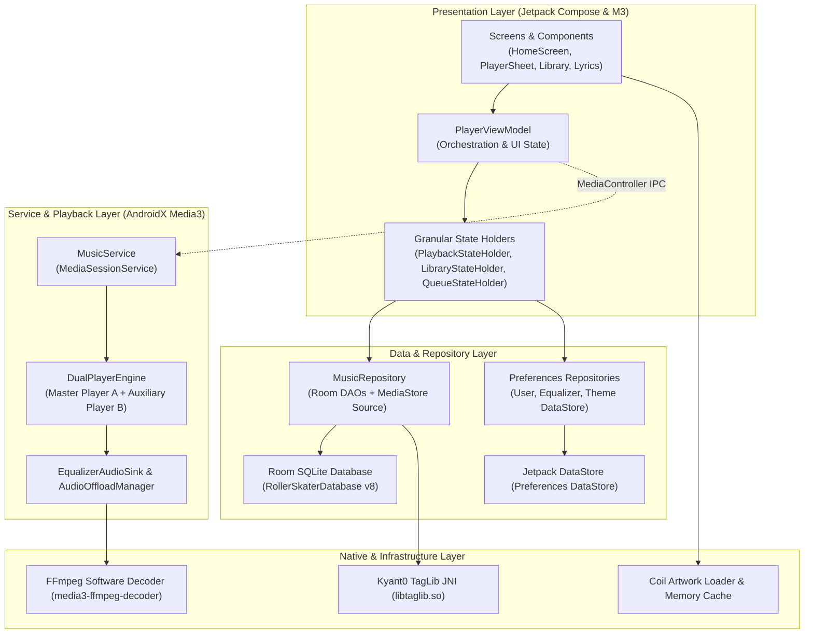

# RollerSkater — System Architecture Manual

This document provides a comprehensive technical guide to the architectural design, subsystems, data flow, and concurrency model of **RollerSkater** (`com.rollerskater.app`).

---

## 1. Architectural Philosophy

RollerSkater is structured around three core architectural tenets:
1. **Unidirectional Data Flow (UDF)**: State flows downwards from repositories and state holders to Composable UI functions; user interactions flow upwards as intent events.
2. **Offline-First & Local Sovereignty**: All metadata, playlist records, listening statistics, and preferences are stored strictly on-device in Room SQLite tables and Jetpack DataStore files.
3. **Hardware-Efficient Audio Pipeline**: Low latency, gapless transitions, and audio offload capabilities powered by AndroidX Media3 and a dual-ExoPlayer engine.

---

## 2. High-Level Architecture

The codebase follows Clean Architecture boundaries divided across four primary layers:



---

## 3. Audio Playback Subsystem

The audio subsystem is located in `data/service/` and `data/service/player/`, centered around `MusicService` and `DualPlayerEngine`.

### DualPlayerEngine Architecture
ExoPlayer natively buffers media sequentially, but crossfading between two distinct audio streams requires simultaneous decoding and playback of two independent audio sources. RollerSkater solves this with **DualPlayerEngine**:

- **Player A (Master Player)**: Handles the currently active playback track. Holds the primary Android `MediaSession` token exposed to system notifications, lock screens, and Android Auto.
- **Player B (Auxiliary Player)**: Pre-buffers the forthcoming track. During a crossfade, Player B begins playback at volume `0.0f` and ramps up while Player A fades down.
- **State Handover**: Once the transition completes, Player A inherits Player B's position and media item, while Player B is paused and reset for the next track pre-buffer.

### Crossfade Mathematical Envelope
Volume attenuation during crossfade transitions is computed through a parabolic envelope function to preserve acoustic energy and prevent perceived dip in loudness:

$$\text{Volume}_{\text{in}}(t) = \sin\left(\frac{\pi}{2} \cdot t\right), \quad \text{Volume}_{\text{out}}(t) = \cos\left(\frac{\pi}{2} \cdot t\right)$$

Where $t \in [0, 1]$ represents the normalized elapsed transition time.

### Audio Offload & HAL Fallback
RollerSkater supports hardware-accelerated audio offload (`AudioSink.OffloadMode`) to maximize battery efficiency during screen-off playback. Because certain device firmware implementations exhibit Audio HAL stall bugs:
1. `DualPlayerEngine` tracks playback readiness timing via `AUDIO_OFFLOAD_STALL_FALLBACK_MS` (1,500ms threshold).
2. If the audio sink stalls in `playWhenReady` without advancing audio positions, the engine automatically records the device offload health metric and falls back gracefully to standard non-offloaded audio pipelines.

### Equalizer Pipeline
Audio equalization is implemented directly within the audio rendering pipeline:
- `EqualizerAudioSink`: Extends Media3's `DefaultAudioSink` to route decoded PCM audio buffers through Android `Equalizer`, `BassBoost`, and `Virtualizer` effects.
- `EqualizerManager`: Coordinates user presets (e.g., Classical, Flat, Rock, Vocal Boost) and custom 5-band to 10-band slider profiles.

---

## 4. UI & Presentation Layer

The presentation layer is located in `presentation/` and built exclusively with **Jetpack Compose** and **Material 3**.

### State Slicing & Anti-Recomposition Pattern
To achieve rock-solid 60–120 FPS rendering across budget and flagship hardware, RollerSkater enforces strict state slicing:
- Rather than observing a monolithic state object inside list items, screens subscribe to granular, derived `StateFlow` streams.
- All derived flows use `.distinctUntilChanged()` to eliminate redundant Compose invalidations:
  ```kotlin
  val currentPlayingSongIdFlow: StateFlow<String?> = playbackStateHolder.stablePlayerState
      .map { it.currentSong?.id }
      .distinctUntilChanged()
      .stateIn(viewModelScope, SharingStarted.WhileSubscribed(5000), null)
  ```

### Screen & Navigation Layout
- **Single Activity**: `MainActivity` hosts the entire UI tree within `AppNavigation`.
- **UnifiedPlayerSheetV2**: The now-playing screen is a gesture-driven bottom sheet offering smooth swipe-to-dismiss, interactive wave seekbars, and fluid tab switches between artwork, lyrics, and the active queue.
- **Adaptive Layouts**: Responsive breakpoint detection dynamically chooses between bottom navigation bars (compact phones), navigation rails (foldables), and modal side drawers (tablets).

---

## 5. Data & Storage Layer

### Room Database (`RollerSkaterDatabase`)
Persistence is managed by Room with exported schemas tracked under `app/schemas/`:
- **Current Version**: `8`
- **Primary Entities**:
  - `SongEntity`: Cached track metadata (ID, title, artist, album, duration, path, genre, bit rate, sample rate, date added).
  - `PlaylistEntity` & `PlaylistSongEntity`: User playlists, descriptions, and track sequence indices.
  - `ListeningStatsEntity`: Daily and monthly listening duration, play counts, and completion metrics.
  - `AlbumArtThemeEntity`: Extracted dominant colors and Material palette values for instant offline theme hydration.
  - `SearchHistoryEntity`: Recent user queries for quick search suggestions.

### Storage Access Framework (SAF)
- Scoped Storage compliance is maintained via SAF `TreeUri` permissions.
- Backups and M3U playlist exports are written directly to user-selected folders using `DocumentsContract` without requiring `MANAGE_EXTERNAL_STORAGE`.

---

## 6. Native & Metadata Utilities

- **TagLib JNI (`libtaglib.so`)**: RollerSkater embeds Kyant0 TagLib native bindings to read and write audio metadata directly to storage files. This bypasses Android MediaStore lag and provides full support for custom tags, Vorbis comments, and embedded APIC artwork frames.
- **Lyrics Engine (`EnhancedLrcParser` & `TtmlLyricsParser`)**: Handles raw `.lrc` and `.ttml` subtitle tracks, parsing word-level millisecond timestamps and normalizing character encodings (UTF-8, UTF-16, GBK).
- **Artwork Cache & Pipeline**: Uses Coil 3 with a dedicated memory and disk caching policy (`LocalArtworkUri`) to deliver instantaneous cover art loading while eliminating image thrashing.

---

## 7. Concurrency & Threading Model

All asynchronous operations use Kotlin Coroutines and Structured Concurrency:
- **`DispatcherProvider`**: Injected abstraction separating work across `Dispatchers.IO` (disk and MediaStore queries), `Dispatchers.Default` (lyrics parsing, palette computation, sorting algorithms), and `Dispatchers.Main` (UI event dispatching).
- **`@AppScope`**: Application-lifetime `CoroutineScope` reserved strictly for critical, non-cancellable transactions such as database checkpoint commits and playlist file sync operations.

---

## 8. Knowledge Graph Navigation

RollerSkater is mapped by `graphify`. When investigating subsystems or cross-community dependencies:
- **Interactive Visualizer**: Open `graphify-out/graph.html` in any modern web browser.
- **Structural Analysis**: Inspect `graphify-out/GRAPH_REPORT.md` for detected hubs, bridges, and module coupling scores.
