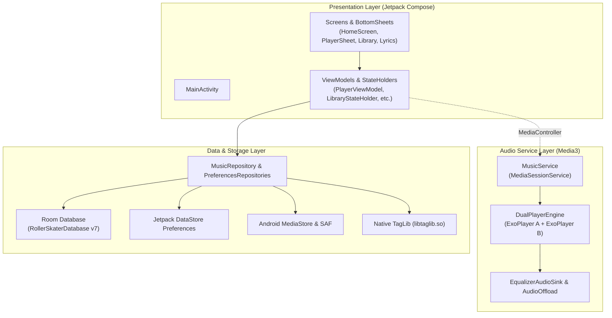

<p align="center">
  
</p>

<h1 align="center">RollerSkater</h1>

<p align="center">
  <strong>A high-performance, offline-first Android music player built with Jetpack Compose, Material 3, and AndroidX Media3.</strong>
</p>

<p align="center">
  <a href="https://github.com/dhyandevp/RollerSkater/actions/workflows/ci.yml"></a>
  <a href="https://github.com/dhyandevp/RollerSkater/releases/latest"></a>
  <a href="LICENSE"></a>
  
  
  
  
</p>

---

## Overview

**RollerSkater** is an independent, local-first Android music player designed for audiophiles and privacy-conscious listeners. Engineered around Android's modern Jetpack Compose toolkit and AndroidX Media3, RollerSkater delivers fluid 60–120 FPS animations, gapless playback, customizable crossfade transitions, embedded & synchronized `.lrc`/`.ttml` lyrics, native tag editing via TagLib, and dynamic Material You personalization—completely free of analytics, telemetry, or remote crash uploaders.

---

## Key Features

### 🎧 Precision Audio Engine
- **DualPlayerEngine**: Dual-player architecture utilizing primary and secondary ExoPlayer instances for seamless gapless playback and crossfades.
- **Parametric Transitions**: Configurable crossfade durations with smooth mathematical volume curve envelopes.
- **Audio Offload Support**: Low-power hardware audio offload with automated fallback detection to ensure uninterrupted playback.
- **Equalizer Integration**: Custom 5-to-10 band equalizer with bass boost, virtualizer, and custom user presets.
- **Extended Audio Codec Decoding**: FFmpeg software decoding extension (`media3-ffmpeg-decoder`) alongside system decoders for broad audio format coverage (MP3, FLAC, M4A/AAC, OGG, OPUS, WAV).

### 🎨 Modern Material 3 UI & Personalization
- **Dynamic Theming**: Dynamic color palette extraction from album artwork via Palette API, with full support for system dynamic themes (Material You).
- **AMOLED True Black**: Deep-black theme mode optimized for OLED and AMOLED displays.
- **Adaptive Layouts**: Responsive navigation across mobile screens, foldable displays, and tablets using AndroidX Window Adaptive APIs.
- **Parallax Carousels & Waveforms**: Hardware-accelerated transitions and interactive seekbars.

### 📚 Comprehensive Library & Tag Management
- **Local Library Organization**: Instant sorting and filtering by Tracks, Albums, Artists, Genres, and Folder hierarchies.
- **Fast Search**: In-memory and indexed database search with recent query history.
- **Native Metadata Editing**: Direct file-level tag editing (ID3v1, ID3v2, FLAC Vorbis comments, MP4 tags) backed by native TagLib JNI (`libtaglib.so`).
- **Flexible Playlists**: Custom playlists, drag-to-reorder queue management, and batch multi-selection tools.

### 🎤 Synchronized Lyrics Engine
- **Multi-Format Parsing**: Instant support for embedded tag lyrics, external `.lrc` synchronized files, and `.ttml` timed text files.
- **Word-Level Highlights**: Real-time karaoke-style word highlighting and smooth auto-scrolling with manual time-offset adjustment.

### 🔒 Offline-First Privacy & Local Backup
- **Zero Telemetry**: Completely devoid of tracking SDKs, Firebase, Crashlytics, and proprietary analytics.
- **Storage Access Framework (SAF)**: Secure local backups and directory access without requiring broad filesystem permissions.
- **JSON Backup & Restore**: One-tap export and import of playlists, favorites, equalizer configurations, listening statistics, and preferences.

### 📱 Android System Integration
- **Glance Home-Screen Widgets**: 4 distinct Material 3 widget layouts (4×1 Bar, 4×2 Controls, 2×2 Album Grid, and Resizable Adaptive Glance) with real-time playback updates, dynamic color palette adaptation, and antialiased rounded bitmap fallbacks on Android 11 (API 30+). See [WIDGET_ARCHITECTURE.md](docs/WIDGET_ARCHITECTURE.md).
- **MediaSession & Notifications**: Full lockscreen playback controls, fast-forward/rewind actions, and Android Auto support.
- **Sleep Timer**: System-level sleep timer with gradual volume fade-out.

---

## Architecture at a Glance

RollerSkater follows Clean Architecture and Unidirectional Data Flow (UDF) design principles:



For an in-depth breakdown of architectural patterns, threading models, and engine state machines, refer to [ARCHITECTURE.md](ARCHITECTURE.md).

---

## Directory Structure

```text
rollerskater/
├── app/
│   ├── schemas/              # Exported Room database schema history (v1 through v7)
│   ├── src/
│   │   ├── main/
│   │   │   ├── assets/       # Fonts, license notices, bundled assets
│   │   │   ├── java/com/rollerskater/app/
│   │   │   │   ├── data/     # Database entities, DAOs, repositories, DataStore preferences
│   │   │   │   ├── di/       # Dagger Hilt dependency injection modules
│   │   │   │   ├── presentation/ # Jetpack Compose UI (screens, sheets, components, viewmodels)
│   │   │   │   ├── service/  # Media3 playback service (MusicService, notification, audio engine)
│   │   │   │   ├── ui/       # Material 3 theme definitions, typography, Glance widgets
│   │   │   │   └── utils/    # TagLib wrappers, lyric parsers, artwork caching utilities
│   │   │   └── res/          # Android drawables, localized strings, XML resources
│   │   └── test/             # Comprehensive JUnit 5 unit test suites
│   └── build.gradle.kts      # Application build configuration
├── baselineprofile/          # Macrobenchmark & Baseline Profile generators
├── docs/                     # Detailed architectural, audio engine, and release documentation
├── gradle/                   # Gradle wrapper and version catalog (libs.versions.toml)
├── NOTICE.md                 # GPL-3.0 attribution and modification notice
├── THIRD_PARTY_NOTICES.md    # Third-party dependency licenses and font notices
├── PRIVACY.md                # Local-first privacy policy
├── CONTRIBUTING.md           # Guidelines for contributors and coding standards
├── ARCHITECTURE.md           # Complete architectural manual
└── README.md                 # Project documentation
```

---

## Documentation Index

For in-depth guides and architectural references:

| Document | Topic |
|---|---|
| 📖 [**COMPILATION_AND_DEVELOPMENT.md**](docs/COMPILATION_AND_DEVELOPMENT.md) | **Step-by-step Android Studio setup, APK compilation, device debugging, and GitHub push workflow** |
| 🏗️ [**ARCHITECTURE.md**](ARCHITECTURE.md) | System architecture, unidirectional data flow (UDF), and layer boundaries |
| 🎛️ [**WIDGET_ARCHITECTURE.md**](docs/WIDGET_ARCHITECTURE.md) | Glance widget design, 4 widget configurations, and Android 11 antialiased rounded fallback |
| 🎵 [**AUDIO_ENGINE.md**](docs/AUDIO_ENGINE.md) | DualPlayerEngine state machine, parametric crossfades, and gapless playback |
| 🗄️ [**DATABASE_SCHEMA.md**](docs/DATABASE_SCHEMA.md) | Room database entity relationships, DAO queries, and version migration history |
| 💾 [**BACKUP_AND_RESTORE.md**](docs/BACKUP_AND_RESTORE.md) | SAF integration and JSON backup/restore schema |
| 🚀 [**RELEASE.md**](docs/RELEASE.md) | Release engineering, APK signing, and automated CI pipelines |
| 🤝 [**CONTRIBUTING.md**](CONTRIBUTING.md) | Contribution guidelines, code standards, and PR workflows |
| 🛡️ [**PRIVACY.md**](PRIVACY.md) | Offline-first, zero-telemetry privacy policy |

---

## Building from Source

For a complete walkthrough on configuring Android Studio, SDK components, and device debugging, see [**COMPILATION_AND_DEVELOPMENT.md**](docs/COMPILATION_AND_DEVELOPMENT.md).

### Quick Compilation Commands

Execute commands from the repository root:

```bash
# 1. Compile Kotlin debug sources
./gradlew :app:compileDebugKotlin

# 2. Assemble Debug APK (outputs to app/build/outputs/apk/debug/)
./gradlew :app:assembleDebug

# 3. Assemble Release APK (unsigned verification build)
./gradlew :app:assembleRelease -Prollerskater.disableReleaseSigning=true

# 4. Run Unit Test Suite
./gradlew :app:testDebugUnitTest --max-workers=2

# 5. Run Android Lint Checks
./gradlew lint
```

---

## Tech Stack & Dependencies

| Category | Libraries / Components |
|---|---|
| **Language & Concurrency** | Kotlin 2.x, Kotlin Coroutines, Kotlin Flow |
| **UI Framework** | Jetpack Compose, Material 3, Material Icons Extended |
| **Audio Engine** | AndroidX Media3 / ExoPlayer, `DualPlayerEngine`, `media3-ffmpeg-decoder` |
| **Dependency Injection** | Dagger Hilt |
| **Persistence** | AndroidX Room (SQLite), Jetpack DataStore (Preferences) |
| **Pagination** | AndroidX Paging 3 |
| **Image Loading** | Coil 3 with custom memory cache decoders |
| **Native Metadata** | Kyant0 TagLib (`libtaglib.so`) |
| **Home Widgets** | AndroidX Glance (Compose for App Widgets) |
| **Testing** | JUnit 5 (Jupiter), MockK, Google Truth, Kotlinx Coroutines Test |

---

## Contributing & Community

We welcome community contributions, bug fixes, and improvements! Please review our community resources before contributing:

- 📖 [Contributing Guidelines](CONTRIBUTING.md) — Build instructions, architectural patterns, and PR workflow.
- 🤝 [Code of Conduct](CODE_OF_CONDUCT.md) — Standards for respectful, inclusive community collaboration.
- 🛡️ [Security Policy](SECURITY.md) — Vulnerability reporting and responsible disclosure policy.
- 💬 [Discussions](https://github.com/dhyandevp/RollerSkater/discussions) — Ask questions, suggest ideas, and share feedback.

> [!IMPORTANT]
> RollerSkater is an independent, standalone project. All contributions must maintain repository isolation and adhere strictly to the project guidelines defined in [AGENTS.md](AGENTS.md) and [CONTRIBUTING.md](CONTRIBUTING.md).

---

## License & Attribution

RollerSkater is free software licensed under the **GNU General Public License v3.0**. See the [LICENSE](LICENSE) file for terms and conditions.

In accordance with GPL-3.0 Section 5, this project preserves historical copyright and license notices of predecessor open-source components. For detailed legal notices and third-party library attributions, see [NOTICE.md](NOTICE.md) and [THIRD_PARTY_NOTICES.md](THIRD_PARTY_NOTICES.md).
