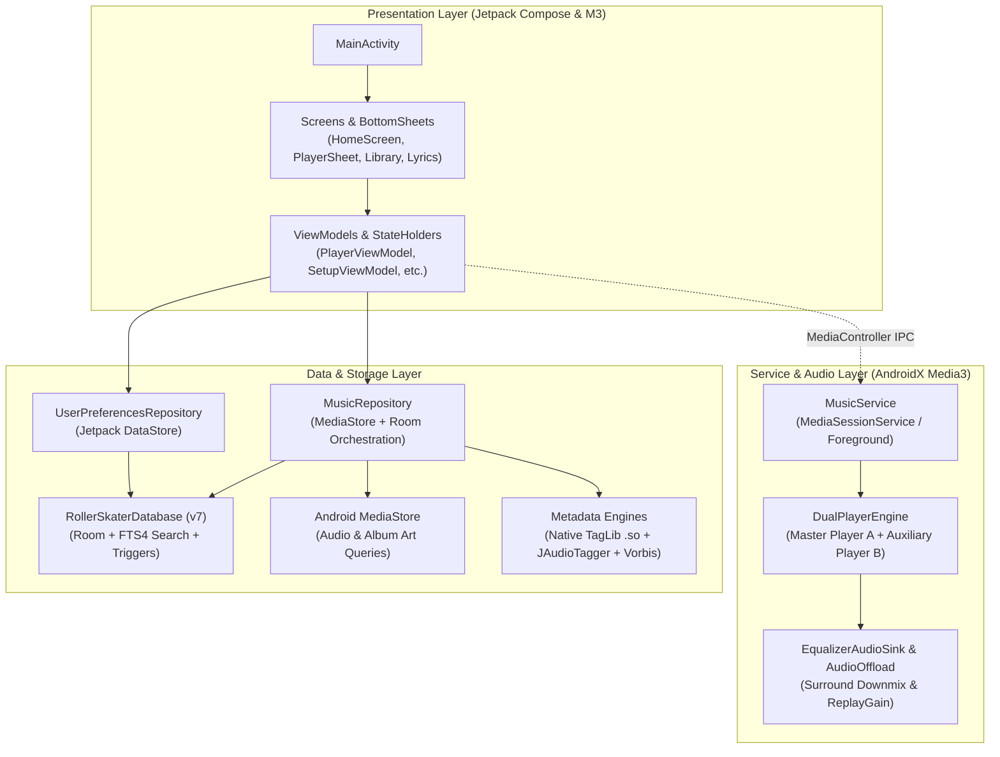

<p align="center">
  
</p>

<h1 align="center">RollerSkater</h1>

<p align="center">
  <strong>An independent, offline-first Android music player built with Jetpack Compose, Material 3, and AndroidX Media3.</strong>
</p>

<p align="center">
  <a href="https://github.com/dhyandevp/RollerSkater/actions/workflows/ci.yml"></a>
  <a href="https://github.com/dhyandevp/RollerSkater/releases/latest"></a>
  <a href="LICENSE"></a>
  
  
  
  
  
  
</p>

---

## Table of Contents
- [Screenshots](#screenshots)
- [Why RollerSkater](#why-rollerskater)
- [Features](#features)
- [Supported Formats & Tag Handling](#supported-formats--tag-handling)
- [Architecture & Design](#architecture--design)
- [Tech Stack](#tech-stack)
- [Permissions & Privacy](#permissions--privacy)
- [Getting Started](#getting-started)
- [Project Structure](#project-structure)
- [Configuration & Settings](#configuration--settings)
- [Testing & Quality Assurance](#testing--quality-assurance)
- [Releasing & Distribution](#releasing--distribution)
- [Roadmap & Known Limitations](#roadmap--known-limitations)
- [Contributing](#contributing)
- [Origin & Credits](#origin--credits)
- [License](#license)

---

## Screenshots

> [!NOTE]
> Screenshot images can be captured from a connected test device or emulator using the ADB commands below and stored in `assets/screenshots/`.

| Home Screen | Full Player | Library Tabs | Synced Lyrics | Equalizer | Glance Widgets |
|:---:|:---:|:---:|:---:|:---:|:---:|
|  |  |  |  |  |  |

<details>
<summary><strong>ADB Commands to Capture Screenshots</strong></summary>

Connect a device with USB debugging enabled and run:
```bash
mkdir -p assets/screenshots
adb exec-out screencap -p > assets/screenshots/01_home.png
adb exec-out screencap -p > assets/screenshots/02_player.png
adb exec-out screencap -p > assets/screenshots/03_library.png
adb exec-out screencap -p > assets/screenshots/04_lyrics.png
adb exec-out screencap -p > assets/screenshots/05_equalizer.png
adb exec-out screencap -p > assets/screenshots/06_widgets.png
```
</details>

---

## Why RollerSkater

RollerSkater is an independent, local-first Android music player engineered for listeners who value audio quality, privacy, and smooth Material 3 design. Built around AndroidX Media3 and a dual-player audio engine, it plays local audio files with gapless transitions, equal-power crossfading, synchronized karaoke lyrics, and low-latency graphic equalization. 

Unlike streaming applications and cloud-tethered players, RollerSkater operates 100% offline by default without tracking SDKs, Firebase, telemetry, or remote crash reporters. All listening statistics, playlists, favorites, and metadata reside exclusively on the device in local SQLite tables. It embraces modern Android standards with full edge-to-edge rendering, predictive back gestures, and backward-compatible home-screen widgets for Android 11 through Android 15+.

---

## Features

Every feature listed below is verified in the source code:

### 🎵 Playback & Audio Engine
- **DualPlayerEngine** ([`DualPlayerEngine.kt`](app/src/main/java/com/rollerskater/app/data/service/player/DualPlayerEngine.kt)): Dual-ExoPlayer architecture (`Player A` master and `Player B` auxiliary) enabling uninterrupted crossfades across mixed sample rates and bit depths without audio dropouts.
- **Parametric Equal-Power Crossfade** ([`EditTransitionScreen.kt`](app/src/main/java/com/rollerskater/app/presentation/screens/EditTransitionScreen.kt), [`TransitionRepositoryImpl.kt`](app/src/main/java/com/rollerskater/app/data/repository/TransitionRepositoryImpl.kt)): Smooth volume interpolation adhering to $\text{Vol}_{\text{in}} = \sin(\frac{\pi}{2}t)$ and $\text{Vol}_{\text{out}} = \cos(\frac{\pi}{2}t)$, maintaining constant acoustic power ($\sin^2 + \cos^2 = 1.0$).
- **Custom Transition Rules** ([`TransitionDao.kt`](app/src/main/java/com/rollerskater/app/data/database/TransitionDao.kt)): Define track-specific or artist-specific crossfade overrides.
- **Extended Codec Decoding** ([`AudioDecoderPolicy.kt`](app/src/main/java/com/rollerskater/app/data/service/player/AudioDecoderPolicy.kt)): FFmpeg software decoding extension (`org.jellyfin.media3:media3-ffmpeg-decoder`) alongside Android platform codecs, enabling direct playback of FLAC (32-bit float PCM direct), ALAC, APE, WMA, AC-3, E-AC-3, DTS, and Opus.
- **Audio Offload with 1,500ms Fallback** ([`DualPlayerEngine.kt`](app/src/main/java/com/rollerskater/app/data/service/player/DualPlayerEngine.kt)): Low-power DSP audio offload with an automated stall detector that switches to standard PCM decoding if hardware drivers freeze.
- **Graphic Equalizer & Reverb** ([`EqualizerScreen.kt`](app/src/main/java/com/rollerskater/app/presentation/screens/EqualizerScreen.kt), [`EqualizerManager.kt`](app/src/main/java/com/rollerskater/app/data/equalizer/EqualizerManager.kt)): Hardware-backed 5–10 band equalizer, Bass Boost, Audio Virtualizer, Reverb presets, and custom user curves.
- **ReplayGain Loudness Normalization** ([`ReplayGainAudioProcessor.kt`](app/src/main/java/com/rollerskater/app/data/service/player/ReplayGainAudioProcessor.kt)): Automatic volume normalization using embedded track and album gain tags.
- **Interactive DJ Mashup Deck** ([`MashupScreen.kt`](app/src/main/java/com/rollerskater/app/presentation/screens/MashupScreen.kt)): Real-time dual-deck mixer with crossfader for blending two tracks live.
- **Drift-Free Sleep Timer** ([`SleepTimerAlarmScheduler.kt`](app/src/main/java/com/rollerskater/app/data/service/SleepTimerAlarmScheduler.kt)): Uses Android `AlarmManager.setExactAndAllowWhileIdle` with gradual volume fade-out to trigger reliably during deep Doze mode.

### 📚 Library & Organization
- **Unified Media Sections** ([`LibraryScreen.kt`](app/src/main/java/com/rollerskater/app/presentation/screens/LibraryScreen.kt), [`LibraryMediaTabs.kt`](app/src/main/java/com/rollerskater/app/presentation/screens/LibraryMediaTabs.kt)): Seven top-level tabs: **Songs**, **Albums**, **Artists**, **Genres**, **Playlists**, **Folders**, and **Favorites**, backed by AndroidX Paging 3.
- **Filesystem Folder Navigation** ([`FolderTreeBuilder.kt`](app/src/main/java/com/rollerskater/app/data/repository/FolderTreeBuilder.kt)): Direct directory browser honoring `.nomedia` files and custom directory exclusions.
- **Directory Blacklisting** ([`ExcludedDirectoriesScreen.kt`](app/src/main/java/com/rollerskater/app/presentation/screens/ExcludedDirectoriesScreen.kt)): Exclude ringtones, podcasts, or voice note folders from music queries.
- **Multi-Artist Delimiter Parsing** ([`DelimiterConfigScreen.kt`](app/src/main/java/com/rollerskater/app/presentation/screens/DelimiterConfigScreen.kt)): Configurable delimiters (`;`, `/`, `&`, `feat.`, `ft.`, `,`) to cleanly split collaborating artists.
- **Duplicate Song Detection** ([`DuplicateSongsScreen.kt`](app/src/main/java/com/rollerskater/app/presentation/screens/DuplicateSongsScreen.kt)): Detect redundant files across storage by matching duration, metadata, and file size.
- **Recently Played Ledger** ([`RecentlyPlayedScreen.kt`](app/src/main/java/com/rollerskater/app/presentation/screens/RecentlyPlayedScreen.kt)): On-device playback history.

### 🔍 Search & Discovery
- **Full-Text SQLite FTS4 Search** ([`SongSearchFtsEntity.kt`](app/src/main/java/com/rollerskater/app/data/database/SongSearchFtsEntity.kt)): Instant search queries with highlighted token matches across titles, artists, and albums using the `unicode61` tokenizer.
- **Genre Exploration Grid** ([`GenreCategoriesGrid.kt`](app/src/main/java/com/rollerskater/app/presentation/screens/search/components/GenreCategoriesGrid.kt)): Visual discovery grid with dynamic typography.
- **Persistent Search History** ([`SearchHistoryDao.kt`](app/src/main/java/com/rollerskater/app/data/database/SearchHistoryDao.kt)): Recent queries with single-item and bulk clear options.

### 🏷️ Metadata & Tag Editor
- **Direct File Tag Editing** ([`SongMetadataEditor.kt`](app/src/main/java/com/rollerskater/app/data/media/SongMetadataEditor.kt)): Direct file-level tag manipulation powered by TagLib C++ bindings (`libtaglib.so`), JAudioTagger, and Vorbis-Java. Supports editing Title, Artist, Album Artist, Album, Year, Track, Disc, Genre, Composer, and ReplayGain values.
- **Technical Audio Inspector** ([`SongInfoBottomSheetViewModel.kt`](app/src/main/java/com/rollerskater/app/presentation/viewmodel/SongInfoBottomSheetViewModel.kt)): Displays bitrate, sample rate, bit depth, codec MIME type, channel configuration, file path, and exact file size.
- **MusicBrainz Lookup** ([`MusicBrainzRepository.kt`](app/src/main/java/com/rollerskater/app/data/musicbrainz/MusicBrainzRepository.kt)): User-initiated metadata matching via `musicbrainz.org` to fetch verified MusicBrainz recording IDs (`mb_recording_id`).
- **System Ringtone & Alarm Setter** ([`SongInfoBottomSheetViewModel.kt`](app/src/main/java/com/rollerskater/app/presentation/viewmodel/SongInfoBottomSheetViewModel.kt)): Assign any track as system ringtone, alarm, or notification sound via Android's `WRITE_SETTINGS` contract.

### 🎤 Synchronized Lyrics
- **Multi-Format Lyrics** ([`LyricsRepositoryImpl.kt`](app/src/main/java/com/rollerskater/app/data/repository/LyricsRepositoryImpl.kt)): Parses embedded ID3 USLT/SYLT tags, Vorbis comment lyrics, local `.lrc` files, and `.ttml` timed text files.
- **Word-Level Highlights** ([`FullPlayerContent.kt`](app/src/main/java/com/rollerskater/app/presentation/components/player/FullPlayerContent.kt)): Real-time karaoke word highlighting and auto-scroll synchronization.
- **Manual Time Offset** ([`LyricsSettingsScreen.kt`](app/src/main/java/com/rollerskater/app/presentation/screens/LyricsSettingsScreen.kt)): Adjust synchronization timing in millisecond increments.
- **LRCLIB Online Fetching (Opt-In)** ([`LrcLibApiService.kt`](app/src/main/java/com/rollerskater/app/data/network/lyrics/LrcLibApiService.kt)): Optional network resolver for missing lyrics from `https://lrclib.net/` (disabled by default; 100% opt-in).

### 📋 Playlists & Audio Bookmarks
- **Custom Playlists** ([`PlaylistDetailScreen.kt`](app/src/main/java/com/rollerskater/app/presentation/screens/PlaylistDetailScreen.kt)): Create and edit playlists with custom covers and descriptions.
- **Drag-and-Drop Reordering** ([`PlaylistDetailScreen.kt`](app/src/main/java/com/rollerskater/app/presentation/screens/PlaylistDetailScreen.kt)): Powered by `sh.calvin.reorderable`.
- **M3U Export & Import** ([`M3uManager.kt`](app/src/main/java/com/rollerskater/app/data/playlist/M3uManager.kt)): Export playlists to standard `.m3u` / `.m3u8` files; import existing playlist files with path matching.
- **Quick Fill Smart Playlists** ([`QuickFillScreen.kt`](app/src/main/java/com/rollerskater/app/presentation/screens/QuickFillScreen.kt)): Build playlists automatically based on rules (most played, release years, or genres).
- **Audio Bookmarks** ([`AudioBookmarksScreen.kt`](app/src/main/java/com/rollerskater/app/presentation/screens/AudioBookmarksScreen.kt)): Save and resume named timestamps inside long tracks, live sets, or podcasts.

### 📊 Private Stats & Recap
- **On-Device Analytics** ([`PlaybackStatsRepository.kt`](app/src/main/java/com/rollerskater/app/data/stats/PlaybackStatsRepository.kt)): Private listening metrics tracking total hours, completion rates, skip counts, and top tracks.
- **Listening Recap Cards** ([`presentation/recap/`](app/src/main/java/com/rollerskater/app/presentation/recap/)): Interactive story cards summarizing listening trends.
- **Card Image Export** ([`RecapSlides.kt`](app/src/main/java/com/rollerskater/app/presentation/recap/RecapSlides.kt)): Export high-resolution recap cards to shareable images via `dev.shreyaspatil:capturable`.

### 🎨 Personalization & System Integration
- **Material You Dynamic Theming** ([`PaletteStyleSettingsScreen.kt`](app/src/main/java/com/rollerskater/app/presentation/screens/PaletteStyleSettingsScreen.kt)): Dynamic color scheme extraction from album artwork via `androidx.palette`.
- **OLED Pure Black Mode** ([`UserPreferencesRepository.kt`](app/src/main/java/com/rollerskater/app/data/preferences/UserPreferencesRepository.kt)): Pure `#000000` dark theme for AMOLED displays.
- **Glance Home-Screen Widgets** ([`ui/glancewidget/`](app/src/main/java/com/rollerskater/app/ui/glancewidget/), [`WIDGET_ARCHITECTURE.md`](docs/WIDGET_ARCHITECTURE.md)): 4 widget layouts (4×1 Bar, 4×2 Controls, 2×2 Album Grid, Resizable Glance) with real-time playback updates and antialiased corner smoothing fallback on Android 11.
- **Quick Settings Tiles** ([`ShuffleAllTileService.kt`](app/src/main/java/com/rollerskater/app/data/service/tile/ShuffleAllTileService.kt), [`LastPlaylistTileService.kt`](app/src/main/java/com/rollerskater/app/data/service/tile/LastPlaylistTileService.kt)): Quick Settings tiles for one-tap shuffle or resuming playback.
- **Backup & Restore** ([`BackupCoordinator.kt`](app/src/main/java/com/rollerskater/app/data/backup/BackupCoordinator.kt), [`BACKUP_AND_RESTORE.md`](docs/BACKUP_AND_RESTORE.md)): Modular on-device JSON export and restore of playlists, favorites, equalizer presets, listening stats, bookmarks, and preferences via Storage Access Framework (SAF).

---

## Supported Formats & Tag Handling

### Audio Decoders
RollerSkater combines native Android media decoders with the bundled **Jellyfin FFmpeg Audio Extension** (`org.jellyfin.media3:media3-ffmpeg-decoder:1.9.0+1`):

| Category | Formats & Codecs Supported |
|---|---|
| **Lossless Audio** | **FLAC** (native + direct 32-bit float PCM decoding via FFmpeg), **ALAC** (Apple Lossless in `.m4a`), **WAV** (PCM 8/16/24/32-bit, IEEE Float), **AIFF**, **APE** (Monkey's Audio). |
| **Lossy Audio** | **MP3** (MPEG-1/2 Audio Layer III), **AAC** (AAC-LC, HE-AAC v1/v2 in `.m4a`, `.mp4`, `.aac`), **Ogg Vorbis** (`.ogg`), **Opus** (`.opus`), **WMA** (Windows Media Audio 1/2/Pro/Lossless), **AC-3** (Dolby Digital), **E-AC-3**, **TrueHD**, **DTS**, **DTS-HD**. |
| **Audio Pipelines** | Direct Hi-Res output up to 192kHz / 24-bit PCM, hardware audio offload with automated 1,500ms stall detection fallback, trigonometric equal-power crossfade, gapless switching, and 5.1 surround-to-stereo downmixing. |

### Tag Engines & Metadata Parsing
Metadata extraction and editing are distributed across three dedicated engines:

1. **Kyant0 TagLib (`io.github.kyant0:taglib:1.0.6`)**: C++ native library (`libtaglib.so`) providing fast parsing of ID3v1, ID3v2.3, ID3v2.4, FLAC Vorbis comments, MP4 tags, and WAV chunks.
2. **JAudioTagger (`net.jthink:jaudiotagger:3.0.1`)**: Advanced tag writer supporting embedded artwork injection, ReplayGain tags (`REPLAYGAIN_TRACK_GAIN`, `REPLAYGAIN_ALBUM_GAIN`), rating fields, and custom TXXX frames.
3. **Vorbis-Java Core (`org.gagravarr:vorbis-java-core:0.8`)**: Specialized Opus and Ogg Vorbis comment parsing and writing.

Supported Metadata Fields: Title, Artist, Album Artist, Multiple Artists (with customizable delimiters), Album, Year, Track Number, Disc Number, Genre, Composer, Embedded Synchronized & Plain Lyrics, Embedded Artwork, and MusicBrainz IDs (`mb_recording_id`, `mb_release_id`, `mb_artist_id`).

---

## Architecture & Design

For deeper technical specifications, sequence diagrams, and concurrency policies, see [docs/ARCHITECTURE.md](docs/ARCHITECTURE.md).



### Package Map

| Package | Purpose | Key Classes |
|---|---|---|
| `com.rollerskater.app.data.database` | Room persistence, DAOs, FTS, and migration strategies | [`RollerSkaterDatabase`](app/src/main/java/com/rollerskater/app/data/database/RollerSkaterDatabase.kt), [`MusicDao`](app/src/main/java/com/rollerskater/app/data/database/MusicDao.kt), [`Migrations`](app/src/main/java/com/rollerskater/app/data/database/Migrations.kt) |
| `com.rollerskater.app.data.repository` | Domain repositories bridging database, preferences, and MediaStore | [`MusicRepository`](app/src/main/java/com/rollerskater/app/data/repository/MusicRepository.kt), [`ArtistImageRepository`](app/src/main/java/com/rollerskater/app/data/repository/ArtistImageRepository.kt) |
| `com.rollerskater.app.data.service` | AndroidX Media3 playback service and notification manager | [`MusicService`](app/src/main/java/com/rollerskater/app/data/service/MusicService.kt), [`MusicNotificationProvider`](app/src/main/java/com/rollerskater/app/data/service/MusicNotificationProvider.kt) |
| `com.rollerskater.app.data.service.player` | DualPlayer audio engine, decoders, offload, and sinks | [`DualPlayerEngine`](app/src/main/java/com/rollerskater/app/data/service/player/DualPlayerEngine.kt), [`AudioDecoderPolicy`](app/src/main/java/com/rollerskater/app/data/service/player/AudioDecoderPolicy.kt) |
| `com.rollerskater.app.data.media` | Audio metadata reading, tag editing, and artwork decoding | [`AudioMetadataReader`](app/src/main/java/com/rollerskater/app/data/media/AudioMetadataReader.kt), [`SongMetadataEditor`](app/src/main/java/com/rollerskater/app/data/media/SongMetadataEditor.kt) |
| `com.rollerskater.app.data.backup` | Modular on-device JSON backup and restoration protocols | [`BackupCoordinator`](app/src/main/java/com/rollerskater/app/data/backup/BackupCoordinator.kt), [`PlaylistsModuleHandler`](app/src/main/java/com/rollerskater/app/data/backup/module/PlaylistsModuleHandler.kt) |
| `com.rollerskater.app.presentation.screens` | Top-level Jetpack Compose screens and navigation destinations | [`HomeScreen`](app/src/main/java/com/rollerskater/app/presentation/screens/HomeScreen.kt), [`LibraryScreen`](app/src/main/java/com/rollerskater/app/presentation/screens/LibraryScreen.kt), [`EqualizerScreen`](app/src/main/java/com/rollerskater/app/presentation/screens/EqualizerScreen.kt) |
| `com.rollerskater.app.presentation.components` | Reusable Compose UI elements, player sheets, and widgets | [`UnifiedPlayerSheetV2`](app/src/main/java/com/rollerskater/app/presentation/components/UnifiedPlayerSheetV2.kt) |
| `com.rollerskater.app.ui.glancewidget` | AndroidX Glance home-screen app widgets and API 30 adapters | [`RollerSkaterGlanceWidget`](app/src/main/java/com/rollerskater/app/ui/glancewidget/RollerSkaterGlanceWidget.kt), [`WidgetUtils`](app/src/main/java/com/rollerskater/app/ui/glancewidget/WidgetUtils.kt) |
| `com.rollerskater.app.di` | Dependency injection modules managed via Dagger Hilt | [`AppModule`](app/src/main/java/com/rollerskater/app/di/AppModule.kt), [`NetworkModule`](app/src/main/java/com/rollerskater/app/di/NetworkModule.kt) |

### Database Schema Summary (Version 8)
Managed by Room in [`RollerSkaterDatabase`](app/src/main/java/com/rollerskater/app/data/database/RollerSkaterDatabase.kt):
- **Current Version**: `8` (Version 8 dropped legacy scrobbling tables for a strictly offline, privacy-first layout).
- **Core Tables**: `songs`, `albums`, `artists`, `song_artist_cross_ref`, `playlists`, `playlist_songs`, `favorites`, `lyrics`, `listening_stats`, `album_art_themes`, `search_history`, `transition_rules`, `audio_bookmarks`.
- **Search Virtual Table**: `songs_fts` using SQLite FTS4 with `unicode61` tokenizer. Automated triggers (`trg_songs_fts_insert`, `trg_songs_fts_update`, `trg_songs_fts_delete`) keep search indexes synchronized without manual re-indexing.
- **Favorites Triggers**: `trg_favorites_insert_sync_song`, `trg_favorites_update_sync_song`, `trg_favorites_delete_sync_song` maintain atomic synchronization between the `favorites` table and `songs.is_favorite`.
- **Migrations**: Fully defined in [`Migrations.kt`](app/src/main/java/com/rollerskater/app/data/database/Migrations.kt) covering `MIGRATION_1_2` through `MIGRATION_7_8`. Schema exports are versioned in `app/schemas/`.

---

## Tech Stack

All dependencies are pinned and verified against [`gradle/libs.versions.toml`](gradle/libs.versions.toml):

| Library / Tool | Version | Purpose in RollerSkater |
|---|---|---|
| **Kotlin** | `2.4.10` | Core programming language with coroutines, Flow, and serialization |
| **Android Gradle Plugin (AGP)** | `9.3.1` | Build orchestration and compilation pipeline |
| **Compose BOM** | `2026.09.00` | Jetpack Compose runtime, foundation, and animation |
| **Material 3** | `1.5.0-beta02` | Material 3 components, color roles, and dynamic typography |
| **Compose Material 3 Adaptive** | `1.0.0` | Responsive layouts for tablets, foldables, and landscape screens |
| **AndroidX Media3** | `1.10.1` | Core media playback engine, ExoPlayer, and MediaSessionService |
| **Jellyfin Media3 FFmpeg Decoder** | `1.9.0+1` | Extended audio codec decoding (`libffmpegJNI.so`, GPL-3.0) |
| **Room** | `2.8.4` | SQLite object mapping, Paging 3 source, and FTS4 virtual table queries |
| **Paging 3** | `3.5.0` | Virtualized list paging for large libraries (10,000+ tracks) |
| **Dagger Hilt** | `2.60.1` | Dependency injection across Activities, Services, and ViewModels |
| **WorkManager** | `2.11.2` | Scheduled background synchronization tasks |
| **Jetpack DataStore** | `1.2.1` | Asynchronous key-value preferences storage |
| **Coil** | `2.7.0` | Asynchronous image loading and album art memory caching |
| **Palette** | `1.0.0` | Dynamic color extraction from artwork for Material You theming |
| **Kyant0 TagLib** | `1.0.6` | Native C++ metadata extraction (`libtaglib.so`) |
| **JAudioTagger** | `3.0.1` | Comprehensive tag writing, ReplayGain, and custom metadata |
| **Vorbis-Java Core** | `0.8` | Opus and Ogg Vorbis comment parsing and writing |
| **AndroidX Glance** | `1.3.0-alpha02` | Jetpack Compose-based home-screen app widgets |
| **Reorderables** | `3.1.0` | Drag-and-drop playlist and queue reordering |
| **Capturable** | `3.0.1` | Bitmap capture for listening recap story cards |
| **Wavy Slider** | `2.2.0` | Animated waveform seekbar in the full-screen player |
| **Timber** | `5.0.1` | Structured logging with StrictMode integration in debug builds |
| **LeakCanary** | `2.14` | Memory leak detection in debug builds |

---

## Permissions & Privacy

For the comprehensive data safety policy, see [PRIVACY.md](PRIVACY.md).

### Manifest Permissions

Every permission declared in [`AndroidManifest.xml`](app/src/main/AndroidManifest.xml) is verified below:

| Permission | Declared In | Used In Code | Justification & Purpose |
|---|---|---|---|
| `INTERNET` | `AndroidManifest.xml:5` | `LrcLibApiService.kt`, `DeezerApiService.kt`, `MusicBrainzApiService.kt`, `AppReleaseSource.kt` | Required for optional online features: fetching missing lyrics, artist portraits, MusicBrainz tags, and update checks. |
| `ACCESS_LOCAL_NETWORK` | `AndroidManifest.xml:6` | *(None)* | Unused in code (relic of removed local streaming servers). Flagged for removal. |
| `ACCESS_NETWORK_STATE` | `AndroidManifest.xml:7` | `ConnectivityStateHolder.kt`, `UpdateCheckWorker.kt` | Monitors network connectivity so background workers run only when connected. |
| `ACCESS_WIFI_STATE` | `AndroidManifest.xml:8` | `ConnectivityStateHolder.kt` | Observes Wi-Fi radio status for playback routing. |
| `BLUETOOTH` | `AndroidManifest.xml:9` | `ConnectivityStateHolder.kt` | Legacy Bluetooth status check on Android 11 (`maxSdkVersion="30"`). |
| `BLUETOOTH_CONNECT` | `AndroidManifest.xml:10` | `ConnectivityStateHolder.kt` | Android 12+ permission to query connected Bluetooth audio devices and battery status. |
| `BLUETOOTH_SCAN` | `AndroidManifest.xml:11` | `ConnectivityStateHolder.kt` | Discovers nearby Bluetooth audio devices with `neverForLocation` flag. |
| `READ_MEDIA_AUDIO` | `AndroidManifest.xml:14` | `SongRepository.kt`, `SetupScreen.kt` | Android 13+ primary permission to index local audio tracks from MediaStore. |
| `READ_MEDIA_IMAGES` | `AndroidManifest.xml:17` | `FolderArtistArtUtils.kt`, `SetupScreen.kt` | Optional permission requested only when user enables reading folder covers (`cover.jpg`). |
| `READ_MEDIA_VISUAL_USER_SELECTED` | `AndroidManifest.xml:19` | `SetupScreen.kt` | Android 14+ permission for partial user selection handling in system photo picker. |
| `READ_EXTERNAL_STORAGE` | `AndroidManifest.xml:20` | `SongRepository.kt` | Storage read permission for Android 11–12 (`maxSdkVersion="32"`). |
| `WAKE_LOCK` | `AndroidManifest.xml:22` | `DualPlayerEngine.kt`, `MusicService.kt` | Prevents CPU sleep during active audio decoding and gapless track transitions. |
| `MODIFY_AUDIO_SETTINGS` | `AndroidManifest.xml:24` | `DualPlayerEngine.kt`, `EqualizerManager.kt` | Configures system equalizer bands, audio effects, and USB DAC bit-perfect output mode. |
| `FOREGROUND_SERVICE` | `AndroidManifest.xml:25` | `MusicService.kt`, `UpdateDownloadService.kt` | Required on Android 9+ for foreground playback services. |
| `FOREGROUND_SERVICE_MEDIA_PLAYBACK` | `AndroidManifest.xml:28` | `MusicService.kt` | Android 14+ specific foreground service type for media playback. |
| `FOREGROUND_SERVICE_DATA_SYNC` | `AndroidManifest.xml:26` | `UpdateDownloadService.kt`, WorkManager | Android 14+ foreground service type for file downloads and WorkManager background sync. |
| `POST_NOTIFICATIONS` | `AndroidManifest.xml:27` | `MusicNotificationProvider.kt`, `SetupScreen.kt` | Android 13+ permission for lockscreen and notification shade playback controls. |
| `WRITE_SETTINGS` | `AndroidManifest.xml:30` | `SongInfoBottomSheetViewModel.kt` | Allows setting any track as system ringtone, alarm, or notification sound. |
| `ACCESS_FINE_LOCATION` | `AndroidManifest.xml:32` | `ConnectivityStateHolder.kt:429` | Declared with `maxSdkVersion="30"`. Used solely on Android 11 to read Wi-Fi SSID name. Flagged as unnecessary for offline playback. |
| `SCHEDULE_EXACT_ALARM` | `AndroidManifest.xml:34` | `AlarmManagerSleepTimerScheduler.kt` | Schedules exact alarm for the Sleep Timer during Doze mode. Inexact fallback is implemented. |
| `REQUEST_INSTALL_PACKAGES` | `AndroidManifest.xml:37` | `AppUpdateManager.kt`, `UpdateInstallReceiver.kt` | In-app APK updater for F-Droid / GitHub builds (prohibited on Google Play). |
| `REQUEST_DELETE_PACKAGES` | `AndroidManifest.xml:38` | `AppUpdateManager.kt` | Prompts uninstallation when switching between F-Droid and GitHub release signatures. |
| `REQUEST_IGNORE_BATTERY_OPTIMIZATIONS` | `AndroidManifest.xml:39` | `SetupScreen.kt` | Prompts user to exempt RollerSkater from aggressive OEM battery killers. |

### Privacy Audit: What Leaves the Device

RollerSkater makes **0 background network calls by default**. There are **no tracking SDKs, no telemetry, and no advertising modules**.

When optional online features are enabled by the user, the exact network endpoints contacted are:
- **`https://api.deezer.com/search/artist`**: Fetches artist portrait artwork. **100% Opt-In** (`externalArtistImagesEnabled` defaults to `false`).
- **`https://lrclib.net/api/`**: Fetches missing synchronized (.lrc) or plain text lyrics. **100% Opt-In** (`externalLyricsEnabled` defaults to `false`).
- **`https://musicbrainz.org/ws/2/`**: User-initiated metadata matching when tapping "Search MusicBrainz" in the track info sheet. **100% Opt-In**.
- **`https://f-droid.org/api/v1/` & `https://api.github.com/`**: In-app update checks and downloads. **Opt-In** in Update settings.

---

## Getting Started

For detailed environment troubleshooting and Android Studio configuration, see [docs/BUILDING.md](docs/BUILDING.md).

### Prerequisites
- **Java Development Kit**: JDK 21 (Eclipse Temurin 21 recommended).
- **Android SDK**: Compile SDK `37`, Target SDK `37`, Minimum SDK `30` (Android 11+).
- **Android Studio**: Ladybug (2024.2.1+) or newer.

### Clone and Build
```bash
# Clone the repository
git clone https://github.com/dhyandevp/RollerSkater.git
cd RollerSkater

# 1. Compile Kotlin debug sources (fast check)
./gradlew :app:compileDebugKotlin

# 2. Assemble Debug APK
./gradlew :app:assembleDebug
# Output APK: app/build/outputs/apk/debug/app-debug.apk

# 3. Assemble Release APKs with ABI splits (arm64-v8a, armeabi-v7a)
./gradlew :app:assembleRelease -Prollerskater.enableAbiSplits=true

# 4. Assemble unsigned Release APK
./gradlew :app:assembleRelease -Prollerskater.disableReleaseSigning=true

# 5. Run all unit tests
./gradlew :app:testDebugUnitTest

# 6. Run Android Lint
./gradlew :app:lintDebug
```

---

## Project Structure

Annotated tree to depth 3:

```
rollerskater/
├── app/
│   ├── schemas/                          # Room database schema export files (v1 through v7)
│   ├── src/
│   │   ├── androidTest/                  # Instrumented Room database and Service tests (33 files)
│   │   ├── main/
│   │   │   ├── assets/                   # Bundled fonts (Google Sans Flex, Roboto Flex) & licenses
│   │   │   ├── java/com/rollerskater/app/
│   │   │   │   ├── data/                 # Database, Room DAOs, DataStore, Repositories, Media, Service
│   │   │   │   ├── di/                   # Hilt DI modules (AppModule, BackupModule, NetworkModule)
│   │   │   │   ├── presentation/         # Jetpack Compose UI (Screens, Sheets, Components, ViewModels)
│   │   │   │   ├── ui/                   # Material 3 Theme, Typography, Glance app widgets
│   │   │   │   └── utils/                # Audio metadata, artwork caching, lyrics parsers
│   │   │   └── res/                      # Android resources, XML drawables, colors, 18 locale folders
│   │   └── test/                         # JVM unit tests (197 files)
│   ├── build.gradle.kts                  # App module build definition (compileSdk 37, JVM 21)
│   └── proguard-rules.pro                # R8 keep rules for Media3, FFmpeg, TagLib, and Room
├── assets/                               # Vector assets (RollerSkater.svg) and store graphics
├── baselineprofile/                      # Macrobenchmarks & Baseline Profile generators (4 files)
├── docs/                                 # Technical documentation
│   ├── ARCHITECTURE.md                   # Deep architecture with sequence diagrams
│   ├── AUDIO_ENGINE.md                   # DualPlayerEngine and crossfade mathematics
│   ├── BACKUP_AND_RESTORE.md             # On-device JSON backup and restore specifications
│   ├── BUILDING.md                       # Compilation manual and build troubleshooting
│   ├── DATABASE_SCHEMA.md                # Room database schema, tables, and migrations
│   ├── DEPENDENCY_LICENSES.md            # Detailed third-party dependency license audit
│   ├── FEATURES.md                       # Comprehensive feature catalog with code references
│   ├── RELEASE.md                        # Release engineering checklist and signing instructions
│   └── WIDGET_ARCHITECTURE.md            # Glance widget design & Android 11 compatibility
├── gradle/                               # Wrapper binaries and version catalogs (libs.versions.toml)
├── NOTICE.md                             # GPL-3.0 attribution and modification notice
├── THIRD_PARTY_NOTICES.md                # Third-party library and asset licenses
├── PRIVACY.md                            # Comprehensive on-device privacy policy
├── LICENSE                               # GNU General Public License v3.0 text
└── README.md                             # Main project documentation
```

---

## Configuration & Settings

- **Settings Storage**: Preferences are stored asynchronously using **Jetpack DataStore** across specialized repositories:
  - [`UserPreferencesRepository`](app/src/main/java/com/rollerskater/app/data/preferences/UserPreferencesRepository.kt): Theming, library sorting, lyrics display, artist image toggles.
  - [`EqualizerPreferencesRepository`](app/src/main/java/com/rollerskater/app/data/preferences/EqualizerPreferencesRepository.kt): Band levels, bass boost, virtualizer, and custom EQ presets.
  - [`PlaylistPreferencesRepository`](app/src/main/java/com/rollerskater/app/data/preferences/PlaylistPreferencesRepository.kt): Playlist view styles and sorting criteria.
- **Backup & Restore Format**: Serialized as reviewable JSON archives or zipped `.rsk` containers via Storage Access Framework (SAF). Includes playlists, favorites, custom equalizer curves, listening statistics, and app preferences.

---

## Testing & Quality Assurance

### Test Suite Summary
- **197 Unit Test Classes** in [`app/src/test/`](app/src/test/): Comprehensive unit tests covering ViewModels, StateHolders, Repositories, Database DAOs, Room Migrations (`MIGRATION_1_2` through `MIGRATION_6_7`), Backup/Restore serializers, AudioMetadata tag parsers, and Widget caches.
- **33 Instrumented Test Classes** in [`app/src/androidTest/`](app/src/androidTest/): Instrumented Room database tests and Android service lifecycles.
- **4 Macrobenchmark & Baseline Profile Classes** in [`baselineprofile/src/`](baselineprofile/src/): Measures cold startup, library scrolling, and player animations on connected devices.

### CI Workflows

Continuous Integration runs via GitHub Actions defined in `.github/workflows/`:

| Workflow File | Trigger | Purpose & Jobs |
|---|---|---|
| [`ci.yml`](.github/workflows/ci.yml) | Push & PR to `main` | Compiles Kotlin debug sources, runs all unit tests (`testDebugUnitTest`), and runs Android Lint (`lintDebug`). |
| [`pr-build.yml`](.github/workflows/pr-build.yml) | Pull Requests | Generates test release APKs with ABI splits, verifies binaries with `aapt2` and `apksigner`, and uploads artifacts. |
| [`release.yml`](.github/workflows/release.yml) | Tag push (`v*.*.*`) | Assembles signed release split APKs, computes SHA-256 checksums, and publishes official GitHub Release. |
| [`alpha-release.yml`](.github/workflows/alpha-release.yml) | Alpha tags | Builds alpha prerelease APKs and archives R8 obfuscation mappings for crash retracing. |
| [`nightly-apk.yml`](.github/workflows/nightly-apk.yml) | Scheduled nightly | Builds nightly APK builds and preserves 30-day workflow artifacts. |

---

## Releasing & Distribution

Summary of release engineering standards from [docs/RELEASE.md](docs/RELEASE.md):
- **Versioning**: Single source of truth in `gradle.properties` (`APP_VERSION_NAME=1.0.0`, `APP_VERSION_CODE=1`).
- **Signing**: Driven by an untracked `keystore.properties` file specifying `storeFile`, `storePassword`, `keyAlias`, and `keyPassword`. Builds default to unsigned if properties are absent.
- **Distribution Channels**:
  - **GitHub Releases**: Signed split APKs (`arm64-v8a`, `armeabi-v7a`) with published SHA-256 checksums.
  - **F-Droid**: Built from tag source using reproducible build environments with release signing disabled (`-Prollerskater.disableReleaseSigning=true`).
  - **Google Play**: Published as an Android App Bundle (`bundleRelease`) via Play App Signing.

---

## Roadmap & Known Limitations

1. **Audio Offload Firmware Quirks**: Certain Android device firmware implementations exhibit Audio HAL stall bugs where the DSP fails to advance audio timestamps; RollerSkater detects this after 1,500ms and gracefully falls back to standard PCM decoding.
2. **In-App Updater on Google Play**: The in-app updater (`data/update/`) and its associated `REQUEST_INSTALL_PACKAGES` permission are intended for F-Droid and GitHub Releases; Google Play policies prohibit apps from self-updating APKs.
3. **Exact Alarms for Sleep Timer**: `SCHEDULE_EXACT_ALARM` ensures drift-free sleep timer execution on Android 12+ during deep Doze mode; for platforms that restrict exact alarms, an inexact alarm fallback is automatically used.

---

## Contributing

RollerSkater welcomes bug reports, translations, and clean code contributions that align with our offline-first architecture. Please read [CONTRIBUTING.md](CONTRIBUTING.md) and [CODE_OF_CONDUCT.md](CODE_OF_CONDUCT.md) before submitting a pull request.

---

## Legal & Attribution

RollerSkater is free software licensed under the GNU General Public License v3.0 (GPL-3.0).

- **Attribution & Notice**: Historical GPL-3.0 attribution notices, fork modification records, and author credits are documented in [`NOTICE.md`](NOTICE.md).
- **Third-Party Notices**: Historical copyright notices from predecessor components are preserved in [`THIRD_PARTY_NOTICES.md`](THIRD_PARTY_NOTICES.md) and [`app/src/main/assets/licenses/`](app/src/main/assets/licenses/).
- **Third-Party Libraries**: All bundled dependencies and their open-source licenses are documented in [`docs/DEPENDENCY_LICENSES.md`](docs/DEPENDENCY_LICENSES.md).

---

## License

RollerSkater is free software licensed under the **GNU General Public License v3.0 or later** ([GPL-3.0-or-later](LICENSE)).

Under GPL-3.0 Section 5:
- You are free to run, study, modify, and redistribute this software.
- If you distribute modified versions or binary builds of RollerSkater, you **must make the complete corresponding source code available under the GPL-3.0**.
- You must preserve all copyright notices, modification records ([`NOTICE.md`](NOTICE.md)), and license files intact.
