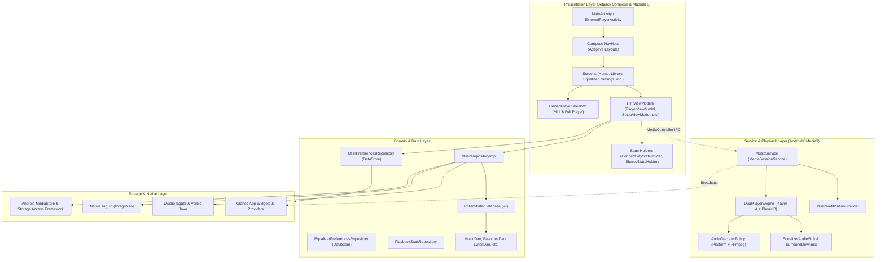
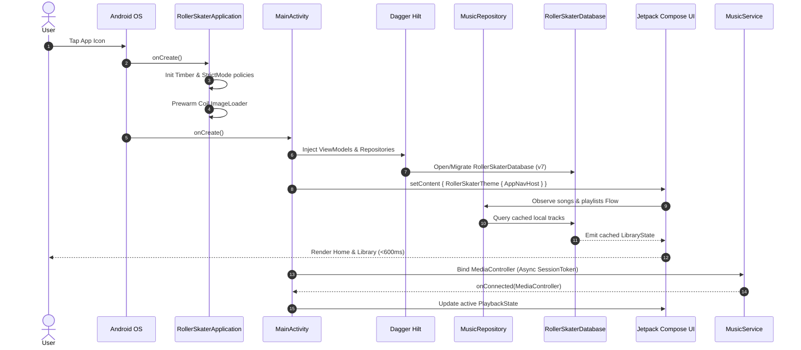
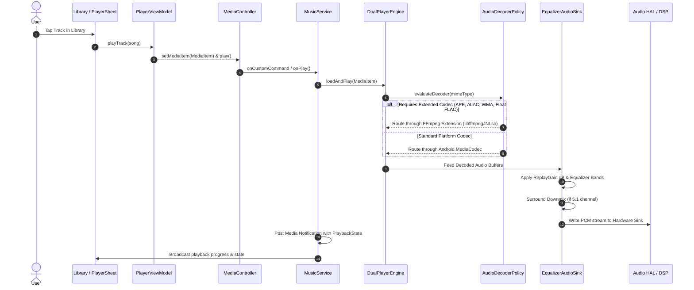
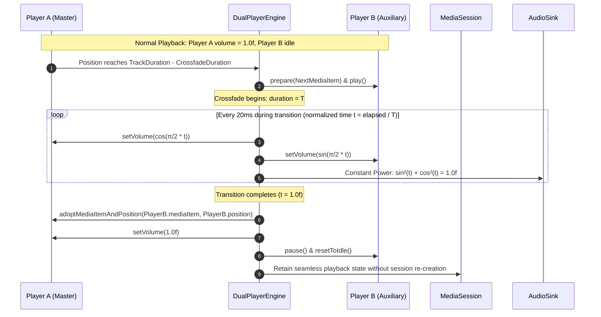
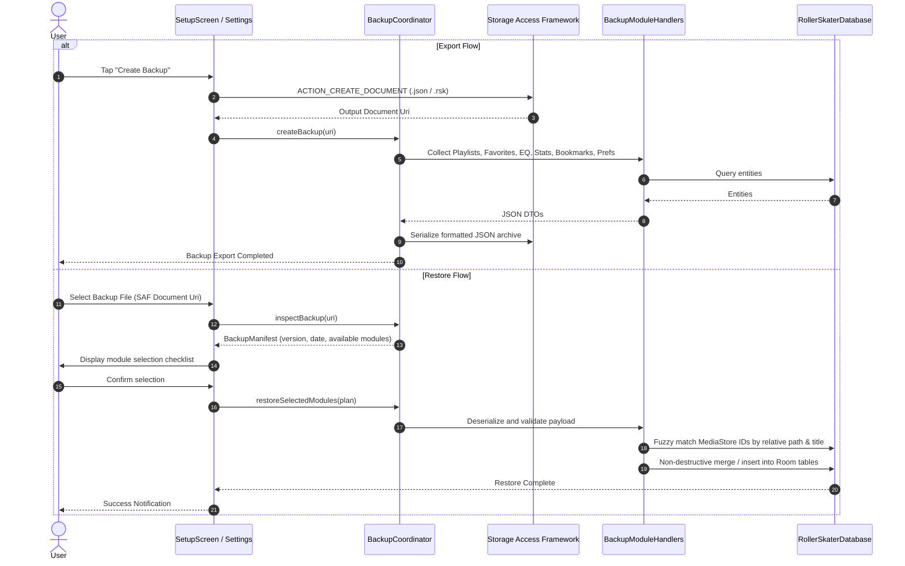

# RollerSkater — Deep Architecture & System Specifications

This document provides in-depth technical specifications, sequence diagrams, subsystem designs, and data flow pipelines for **RollerSkater** (`com.rollerskater.app`).

---

## 1. Architectural Blueprint & Layers

RollerSkater is structured according to Unidirectional Data Flow (UDF) and Clean Architecture principles:



---

## 2. Sequence Diagram 1: Cold App Startup



---

## 3. Sequence Diagram 2: MediaStore Synchronization & Library Indexing

```mermaid
sequenceDiagram
    autonumber
    participant Worker as SyncWorker / Repo
    participant MediaStore as Android MediaStore
    participant Excluded as ExcludedDirectories
    participant TagLib as Kyant0 TagLib (.so)
    participant Room as Room SQLite DB
    participant FTS as songs_fts (FTS4)
    participant UI as Compose UI (Paging 3)

    Worker->>MediaStore: query(MediaStore.Audio.Media.EXTERNAL_CONTENT_URI)
    MediaStore-->>Worker: Cursor (id, path, date_modified, duration)
    Worker->>Excluded: Filter blacklisted folders / .nomedia
    Worker->>Room: Compare date_modified with existing SongEntities
    alt Track is New or File Modified
        Worker->>TagLib: Extract tags (ID3v2, Vorbis, MP4)
        TagLib-->>Worker: AudioMetadata (Title, Artist, Album, ReplayGain, MBIDs)
        Worker->>Worker: Parse multi-artist delimiters (;, /, &, feat.)
    end
    Worker->>Room: Bulk Insert/Update SongEntities (In Transaction)
    Room->>FTS: SQLite Triggers fire (trg_songs_fts_insert / update)
    FTS-->>Room: Update unicode61 virtual search table
    Room-->>UI: Room PagingSource invalidates & emits new PagingData
    UI-->>UI: Re-render list with stable keys (song.id)
```

---

## 4. Sequence Diagram 3: Track Playback & Equalizer Pipeline



---

## 5. Sequence Diagram 4: Dual-Player Gapless & Equal-Power Crossfade



---

## 6. Sequence Diagram 5: On-Device Backup & Restore Pipeline


