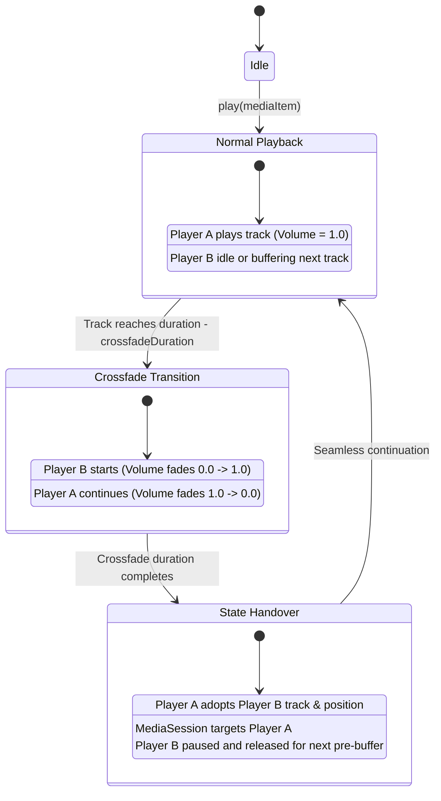

# Audio Engine Specification — DualPlayerEngine

This document describes the design, operational states, and mathematical principles governing RollerSkater's **DualPlayerEngine** (`com.rollerskater.app.data.service.player.DualPlayerEngine`).

---

## 1. Motivation for a Dual-Player Engine

Standard Android audio implementations relying on a single `ExoPlayer` instance face inherent limitations when performing crossfades:
1. An individual player cannot simultaneously decode and mix two separate media containers with different sample rates, bit depths, or audio formats.
2. Hardware audio offload sinks cannot process interleaved samples from two non-aligned streams.

**DualPlayerEngine** overcomes this by orchestrating two distinct `ExoPlayer` instances (`Player A` and `Player B`) synchronized via a state machine.

---

## 2. Dual-Player Roles & State Machine

### Roles:
- **Player A (Master)**: Exposes the primary `MediaSession` token to the operating system (status bar notifications, lockscreen playback, Bluetooth metadata, Android Auto).
- **Player B (Auxiliary)**: Dedicated to pre-buffering upcoming queue items and fading in during crossfade transitions.

---

## 3. Crossfade Volume Envelope & Attenuation

Linear crossfades cause a perceptible drop in sound energy at the midpoint ($t = 0.5$). To prevent this "energy dip", RollerSkater computes volume multipliers using an equal-power trigonometric curve:

$$\text{Volume}_{\text{in}}(t) = \sin\left(\frac{\pi}{2} \cdot t\right)$$
$$\text{Volume}_{\text{out}}(t) = \cos\left(\frac{\pi}{2} \cdot t\right)$$

Where $t = \frac{\text{elapsedTime}}{\text{transitionDuration}}$, bounded in $[0.0, 1.0]$.

This ensures that the combined audio power across both players remains constant throughout the transition:

$$\text{Volume}_{\text{in}}^2(t) + \text{Volume}_{\text{out}}^2(t) = \sin^2\left(\frac{\pi}{2} \cdot t\right) + \cos^2\left(\frac{\pi}{2} \cdot t\right) = 1.0$$

---

## 4. Gapless Playback vs. Crossfade

RollerSkater allows users to choose between two transition paradigms:

1. **Gapless Playback (Zero Crossfade)**:
   - When crossfade is disabled (`duration = 0`), Player A loads the next `MediaItem` into its internal playlist queue.
   - ExoPlayer uses its native seamless handoff to switch track buffers without resetting the audio sink, preserving true gapless transitions for live albums and classical movements.

2. **Crossfade Playback**:
   - When crossfade is enabled (`duration > 0`), the auxiliary Player B pre-buffers the next track.
   - At the threshold timestamp ($t_{\text{start}} = \text{TrackDuration} - \text{CrossfadeDuration}$), Player B starts playback and the volume envelope begins interpolation.

---

## 5. Hardware Audio Offload & Fallback Recovery

Android's Audio Offload allows the CPU to enter deep sleep states while an external DSP decodes compressed audio streams.

### Challenges:
Certain hardware chipsets and custom ROMs contain faulty Audio HAL offload drivers that accept offload buffers but fail to advance playback positions (Audio HAL stall).

### The 1,500ms Fallback Mechanism:
1. When playback begins with audio offload enabled, `DualPlayerEngine` starts an internal readiness monitor.
2. If the player reports `playWhenReady == true` and `playbackState == Player.STATE_READY`, but the audio presentation position fails to advance within `1,500ms`:
   - The engine logs the offload stall event.
   - The engine automatically disables offload for the offending audio session.
   - The audio pipeline seamlessly restarts using standard low-latency PCM decoding without interrupting the user.
