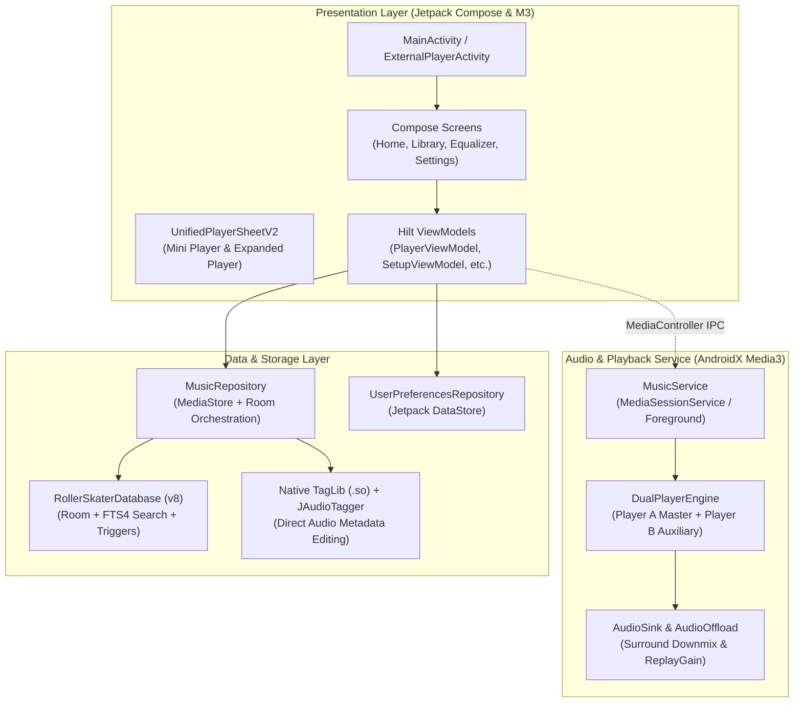

# RollerSkater Documentation Portal

Welcome to the **RollerSkater** technical documentation. RollerSkater is an independent, offline-first Android music player engineered with Jetpack Compose, Material 3, AndroidX Media3, and Kotlin Coroutines/Flow.

Whether you are an end user setting up your local library, a contributor submitting code, or a security researcher auditing our on-device privacy boundaries, this documentation directory contains exhaustive specifications.

---

## 🗺️ Documentation Directory

### 🚀 Getting Started & User Guides
- **[Installation Guide](installation.md)**: Download APKs, sideload on Android 11–15+, install via F-Droid or GitHub Releases, and verify SHA-256 checksums.
- **[Getting Started](getting-started.md)**: Initial onboarding, media library indexing, setting folder exclusions, multi-artist delimiter setup, and importing M3U playlists.
- **[Configuration & Preferences](configuration.md)**: Comprehensive reference of on-device settings stored in Jetpack DataStore (playback buffer, audio offload, crossfade curves, equalizer presets, AMOLED theming).
- **[Feature Catalog](FEATURES.md)**: Verified breakdown of every audio engine, library, search, tag editor, lyrics, and widget capability with direct source code references.

### 🎧 Audio & Engine Specifications
- **[Audio Engine Deep Dive](AUDIO_ENGINE.md)**: DualPlayerEngine architecture, equal-power trigonometric crossfade mathematics ($\sin/\cos$), hardware audio offload with 1,500ms stall fallback, and Jellyfin FFmpeg software decoders.
- **[Widget Architecture](WIDGET_ARCHITECTURE.md)**: AndroidX Glance home-screen AppWidgets, responsive layouts (4×1, 4×2, 2×2), on-device album art bitmap caches, and Android 11 antialiasing fallbacks.
- **[Backup & Restore Protocol](BACKUP_AND_RESTORE.md)**: Modular on-device JSON schema, atomic export/import procedures, and Storage Access Framework (SAF) integration.

### 🏛️ Architecture & Database
- **[Architecture & System Design](ARCHITECTURE.md)**: Clean Architecture layers, Unidirectional Data Flow (UDF), MediaSessionService IPC, Hilt dependency injection graphs, and concurrency policies.
- **[System & Flow Diagrams](diagrams/README.md)**: Standalone Mermaid diagram specifications visualizing architecture, MediaStore synchronization, crossfade lifecycles, and backup flows.
- **[Database Schema & Migrations](DATABASE_SCHEMA.md)**: Room database schema (Version 8), SQLite FTS4 virtual tables, automated sync triggers, and migration strategies (`MIGRATION_1_2` through `MIGRATION_7_8`).

### 💻 Developer & Contributor Guides
- **[Development Setup](development.md)**: Android Studio configuration, JDK 21 setup, Gradle build flags, Compose compiler stability rules, and coding conventions.
- **[Building & Compilation](BUILDING.md)**: Fast Kotlin compilation, assembling debug/release APKs, ABI splits (`arm64-v8a`, `armeabi-v7a`), and App Bundle (`.aab`) generation.
- **[Testing & Quality Assurance](testing.md)**: Running the 197 JUnit 5 JVM unit test classes, instrumented Room database tests, MockK/Turbine flows, and Android Lint analysis.
- **[Release Engineering & Deployment](deployment.md)**: Local keystore generation, GitHub Actions automated releases, F-Droid reproducible build parameters, and Google Play bundle signing.

### 🛡️ Support, Safety & FAQ
- **[Troubleshooting Guide](troubleshooting.md)**: Diagnostics and step-by-step solutions for permission denials, playback halts during screen-off, Bluetooth latency, and tag editing issues.
- **[Frequently Asked Questions (FAQ)](faq.md)**: Common queries regarding offline sovereignty, supported audio formats, ReplayGain, lyrics parsing, and battery optimization exemptions.
- **[Dependency License Audit](DEPENDENCY_LICENSES.md)**: Full compliance audit of all third-party libraries, native C++ bindings, and GPL-3.0 compatibility notices.

---

## 📐 High-Level Architecture Overview

---

## 🤝 Contributing to Documentation

We welcome improvements, typo corrections, translations, and architectural diagrams. Please refer to [CONTRIBUTING.md](../CONTRIBUTING.md) for style guidelines before submitting a pull request.
