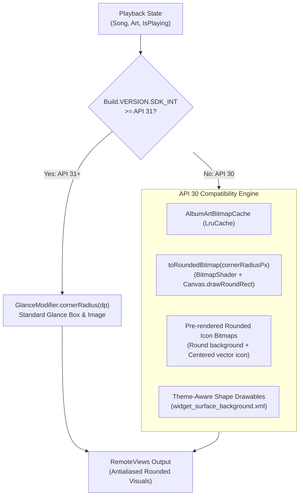

# RollerSkater — Glance Widget Architecture & Android 11 Compatibility

RollerSkater features home-screen playback widgets built with **AndroidX Glance** (Jetpack Compose for RemoteViews). This document outlines the widget design, lifecycle, and backwards-compatibility architecture for Android 11 (API 30).

---

## 1. Widget Catalog

RollerSkater provides four distinct widget configurations tailored to different home-screen grid sizes and user workflows:

| Widget | Dimensions | Component Class | XML Provider |
|---|---|---|---|
| **Bar Widget** | 4×1 | `BarWidget4x1` | `@xml/bar_widget_4x1_info` |
| **Control Widget** | 4×2 | `ControlWidget4x2` | `@xml/control_widget_4x2_info` |
| **Grid Widget** | 2×2 | `GridWidget2x2` | `@xml/grid_widget_2x2_info` |
| **Adaptive Glance** | Responsive | `RollerSkaterGlanceWidget` | `@xml/rollerskater_glance_widget_info` |

---

## 2. Technical Challenge on Android 11 (API 30)

RollerSkater targets `minSdk = 30` (Android 11) up to `compileSdk = 37`.

On Android 12+ (API 31+), Android added `RemoteViews.setViewOutlinePreferredRadius()`, allowing Jetpack Glance's `GlanceModifier.cornerRadius(dp)` to clip views natively on the launcher.

On Android 11 (API 30):
1. **No Native Outline Clipping**: Calling `GlanceModifier.cornerRadius()` logs:
   ```
   Cannot set the rounded corner of views before Api 31.
   ```
2. **Glance Background Limitations**: `BackgroundModifier` only supports color integers or XML drawables; it does not clip bitmap backgrounds.
3. **Launcher Sizing Rules**: Android 11 launcher grids ignore `targetCellWidth` and `targetCellHeight`, calculating widget cells strictly from `minWidth` and `minHeight`.

---

## 3. Backwards-Compatibility Architecture

To ensure widgets render with smooth, modern rounded surfaces on Android 11:



### Key Components

1. **`Bitmap.toRoundedBitmap()`** (`WidgetUtils.kt`):
   - Computes a matrix center-crop scale.
   - Attaches a `BitmapShader` and paints onto a newly allocated ARGB_8888 bitmap using `Canvas.drawRoundRect()`.
   - The outer corner corners are 100% alpha transparent, avoiding clipping glitches.

2. **`AlbumArtBitmapCache`** (`WidgetUtils.kt`):
   - In-memory `androidx.collection.LruCache` caching scaled, rounded artwork by song data hash or URI.
   - Provides instant cached access during frequent widget updates without disk I/O.

3. **`getButtonBitmap()` & `getPlaceholderBitmap()`**:
   - Synthesizes vector drawables into pre-clipped rounded bitmaps with theme-adaptive background circles on API 30.

4. **Day / Night Theme Drawables**:
   - `res/values/colors.xml` and `res/values-night/colors.xml` declare `widget_surface_background_color` and `widget_button_secondary_color`.
   - `res/drawable/widget_surface_background.xml` applies 24dp rounded corners using theme-aware colors when dynamic palette extraction is unavailable.

---

## 4. Testing & Verification

Widget cache behavior is verified by JVM unit tests in:
- `app/src/test/java/com/rollerskater/app/ui/glancewidget/AlbumArtBitmapCacheTest.kt`

Run tests via:
```bash
./gradlew :app:testDebugUnitTest --tests "com.rollerskater.app.ui.glancewidget.*" --max-workers=2
```
