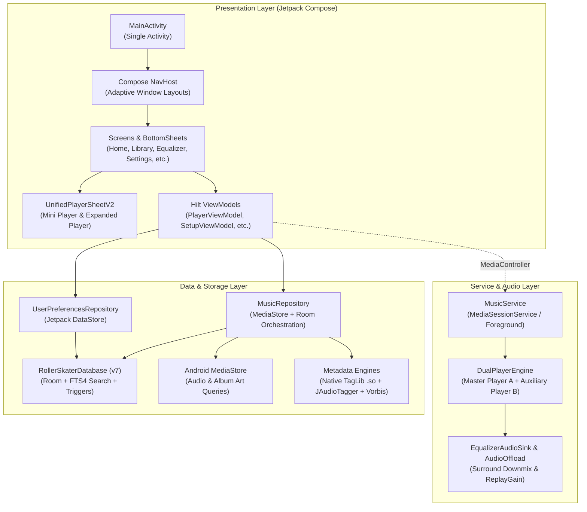

# RollerSkater — Codebase Analysis & Verification Report

**Date**: November 2026  
**Repository**: `com.rollerskater.app` (RollerSkater)  
**Target Release**: 1.0.0 (API 30–37)

---

## 1. Ground Truth & Core Verification

Every item below was verified directly against the source code in `app/build.gradle.kts`, `settings.gradle.kts`, `gradle/libs.versions.toml`, `AndroidManifest.xml`, and Room schema definitions.

### Project & Module Coordinates
- **Root Project Name**: `RollerSkater` (`settings.gradle.kts`)
- **Modules**:
  - `:app`: Main Android application (Compose UI, Media3 playback service, Room database, DataStore).
  - `:baselineprofile`: Macrobenchmarks and Baseline Profile generators (`androidx.benchmark.macro.junit4`).
- **Application ID**: `com.rollerskater.app` (`app/build.gradle.kts`, debug builds append `.debug`)
- **SDK Targets**:
  - `minSdk`: `30` (Android 11)
  - `targetSdk`: `37`
  - `compileSdk`: `37`
- **Toolchain Versions**:
  - Gradle: `9.6.1`
  - Android Gradle Plugin (AGP): `9.3.1`
  - Kotlin: `2.4.10`
  - Java Target: `JavaVersion.VERSION_21` (Java 21 bytecode with core library desugaring `desugar_jdk_libs:2.1.5`)
  - KSP: `2.3.10`
  - Compose BOM: `2026.09.00` (Material 3 `1.5.0-beta02`, Adaptive `1.0.0`)
  - Dagger Hilt: `2.60.1`
  - Room: `2.8.4`
  - Media3: `1.10.1`

### Source Tree Statistics
- **Total Kotlin Files**: 796 `.kt` files across the repository.
- **Main App Sources (`app/src/main/java`)**: 562 files.
- **Unit Tests (`app/src/test`)**: 197 files.
- **Instrumented Tests (`app/src/androidTest`)**: 33 files.
- **Baseline Profile / Benchmark (`baselineprofile/src`)**: 4 files.
- **Room Database Version**: **`7`** (Schema export: `app/schemas/com.rollerskater.app.data.database.RollerSkaterDatabase/7.json`). *Note: Initial assumptions of version 6 were outdated; version 7 dropped legacy cloud streaming and offline caching tables.*
- **Packaged Locales**: 16 languages filtered in `app/build.gradle.kts` (`en`, `ar`, `cs`, `de`, `es`, `fr`, `in`, `it`, `ko`, `nb`, `pt-rBR`, `ru`, `sk`, `tr`, `zh-rCN`, `vi`).

---

## 2. Architectural Structure & Data Flow

### Key Entry Points
1. **Application**: `com.rollerskater.app.RollerSkaterApplication`
   - Initializes Timber logging (`DebugTree` with StrictMode thread/VM policies in debug, `ReleaseTree` in release).
   - Pre-warms Coil image loader (`CoilBitmapLoader`).
   - Initializes WorkManager with on-demand configuration (`Configuration.Provider`).
2. **Activities**:
   - `MainActivity`: Single-activity entry point. Hosts edge-to-edge Compose hierarchy, splash screen animation, predictive back handling, and navigation.
   - `ExternalPlayerActivity`: Lightweight playback intent target for external audio files (`android.intent.action.VIEW` / `SEND` with `audio/*` mime types).
3. **Services**:
   - `MusicService`: Core AndroidX `MediaSessionService` foreground service (`foregroundServiceType="mediaPlayback"`). Hosts `DualPlayerEngine`.
   - `UpdateDownloadService`: Foreground service (`foregroundServiceType="dataSync"`) downloading APK releases with notification progress.
   - `ShuffleAllTileService` & `LastPlaylistTileService`: Quick Settings tiles (`BIND_QUICK_SETTINGS_TILE`).
4. **Receivers**:
   - `SleepTimerReceiver`: Receives exact alarm broadcasts to pause playback.
   - `RollerSkaterMediaButtonReceiver`: Headset and hardware media button handling.
   - `WidgetUpdateReceiver`: Internal broadcast receiver updating Glance widgets.
   - Glance Receivers: `BarWidget4x1Receiver`, `ControlWidget4x2Receiver`, `GridWidget2x2Receiver`, `RollerSkaterGlanceWidgetReceiver`.
   - `UpdateInstallReceiver`: Broadcast receiver triggering APK installation via package installer session.
5. **Content Providers**:
   - `SharedArtworkContentProvider`: Exposes cached artwork bitmaps via `content://com.rollerskater.app.artwork` for widgets and external system UI.
   - `FileProvider`: Secure file sharing for crash reports, exports, and temporary update APKs.
6. **WorkManager Workers**:
   - `SyncWorker`: Scheduled background sync of media store updates.
   - `ScrobbleFlushWorker`: Backoff retry flush of queued ListenBrainz listens.
   - `UpdateCheckWorker`: Periodic background check for published app updates.

---

## 3. Permissions Analysis & Justifications

| Manifest Permission | Declared In | Used In Code | Purpose & Functionality | Audit Status & Recommendation |
|---|---|---|---|---|
| `android.permission.INTERNET` | `AndroidManifest.xml:5` | `AppReleaseSource.kt`, `LrcLibApiService.kt`, `DeezerApiService.kt`, `MusicBrainzApiService.kt`, `ListenBrainzRepository.kt` | Required for optional online features: LRCLIB lyrics, Deezer artist art, MusicBrainz metadata lookup, ListenBrainz scrobbling, and in-app update checks. | **Keep** if online opt-in features are kept; **Remove** if app ships as 100% strictly air-gapped. |
| `android.permission.ACCESS_LOCAL_NETWORK` | `AndroidManifest.xml:6` | *(None)* | Unused anywhere in source code. Originally added in upstream for local streaming server discovery. | ⚠️ **Unnecessary**. Recommend removing from manifest. |
| `android.permission.ACCESS_NETWORK_STATE` | `AndroidManifest.xml:7` | `ConnectivityStateHolder.kt`, `UpdateCheckWorker.kt`, `ScrobbleFlushWorker.kt` | Used by WorkManager constraints and connectivity monitors to detect active internet before executing network calls. | **Valid** for network-aware workers. |
| `android.permission.ACCESS_WIFI_STATE` | `AndroidManifest.xml:8` | `ConnectivityStateHolder.kt` | Used to listen for `WIFI_STATE_CHANGED_ACTION` and query Wi-Fi radio status. | **Valid**. |
| `android.permission.BLUETOOTH` | `AndroidManifest.xml:9` | `ConnectivityStateHolder.kt` | Legacy Bluetooth status check on Android 11 (`maxSdkVersion="30"`). | **Valid** (scoped to API 30). |
| `android.permission.BLUETOOTH_CONNECT` | `AndroidManifest.xml:10` | `ConnectivityStateHolder.kt` | Android 12+ permission to query connected Bluetooth audio devices, headset battery percentage, and active output name. | **Valid**. |
| `android.permission.BLUETOOTH_SCAN` | `AndroidManifest.xml:11` | `ConnectivityStateHolder.kt` | Declared with `usesPermissionFlags="neverForLocation"` for audio device discovery. | **Valid**. |
| `android.permission.READ_MEDIA_AUDIO` | `AndroidManifest.xml:14` | `SongRepository.kt`, `SetupScreen.kt` | Android 13+ primary permission for indexing and reading audio files from the device media store. | **Mandatory**. |
| `android.permission.READ_MEDIA_IMAGES` | `AndroidManifest.xml:17` | `FolderArtistArtUtils.kt`, `SetupScreen.kt` | Optional permission requested only when the user enables folder cover artwork (`cover.jpg`, `folder.jpg`) stored next to audio files. | **Valid** (opt-in). |
| `android.permission.READ_MEDIA_VISUAL_USER_SELECTED` | `AndroidManifest.xml:19` | `SetupScreen.kt` | Android 14+ permission for partial access handling when user selects specific images for custom playlist artwork. | **Valid**. |
| `android.permission.READ_EXTERNAL_STORAGE` | `AndroidManifest.xml:20` | `SongRepository.kt` | Storage read permission for Android 11–12 (`maxSdkVersion="32"`). | **Mandatory** for API 30–32. |
| `android.permission.WAKE_LOCK` | `AndroidManifest.xml:22` | `DualPlayerEngine.kt`, `MusicService.kt` | Prevents the CPU from entering deep sleep during active audio decoding and gapless track transitions. | **Mandatory** for background playback. |
| `android.permission.MODIFY_AUDIO_SETTINGS` | `AndroidManifest.xml:24` | `DualPlayerEngine.kt`, `EqualizerManager.kt` | Normal permission used to configure system audio effects, equalizer bands, and USB DAC bit-perfect output mode. | **Valid**. |
| `android.permission.FOREGROUND_SERVICE` | `AndroidManifest.xml:25` | `MusicService.kt`, `UpdateDownloadService.kt` | Required for long-running playback and download operations. | **Mandatory**. |
| `android.permission.FOREGROUND_SERVICE_MEDIA_PLAYBACK` | `AndroidManifest.xml:28` | `MusicService.kt` | Android 14+ foreground service type for media playback. | **Mandatory**. |
| `android.permission.FOREGROUND_SERVICE_DATA_SYNC` | `AndroidManifest.xml:26` | `UpdateDownloadService.kt`, `WorkManager` | Android 14+ foreground service type for file downloads and WorkManager background sync. | **Valid**. |
| `android.permission.POST_NOTIFICATIONS` | `AndroidManifest.xml:27` | `MusicNotificationProvider.kt`, `SetupScreen.kt` | Android 13+ permission to show media playback controls in the notification shade and lockscreen. | **Mandatory**. |
| `android.permission.WRITE_SETTINGS` | `AndroidManifest.xml:30` | `SongInfoBottomSheetViewModel.kt` | Allows user to set any song as system ringtone, alarm, or notification sound (`ACTION_MANAGE_WRITE_SETTINGS`). | **Valid** (opt-in feature). |
| `android.permission.ACCESS_FINE_LOCATION` | `AndroidManifest.xml:32` | `ConnectivityStateHolder.kt:429` | Declared with `maxSdkVersion="30"`. Used solely on Android 11 to read the connected Wi-Fi SSID name via `WifiInfo.getSSID()`. | ⚠️ **Unnecessary / Play Risk**. High friction on Play Store. Music players do not need Wi-Fi SSID names. |
| `android.permission.SCHEDULE_EXACT_ALARM` | `AndroidManifest.xml:34` | `AlarmManagerSleepTimerScheduler.kt` | Schedules exact alarm for the Sleep Timer so it fires reliably during Doze mode. | ⚠️ **Play Store Risk**. Google Play restricts exact alarms. Fallback to `setAndAllowWhileIdle` is already coded. |
| `android.permission.REQUEST_INSTALL_PACKAGES` | `AndroidManifest.xml:37` | `AppUpdateManager.kt`, `UpdateInstallReceiver.kt` | Prompts the user to install downloaded APK updates directly inside the app. | ⚠️ **Forbidden on Google Play**. Legitimate for F-Droid / GitHub releases only. |
| `android.permission.REQUEST_DELETE_PACKAGES` | `AndroidManifest.xml:38` | `AppUpdateManager.kt` | Triggers package uninstallation when switching between F-Droid and GitHub release signatures. | ⚠️ **Forbidden on Google Play**. Legitimate for F-Droid / GitHub releases only. |
| `android.permission.REQUEST_IGNORE_BATTERY_OPTIMIZATIONS` | `AndroidManifest.xml:39` | `SetupScreen.kt`, `SetupViewModel.kt` | Prompts the user to exempt RollerSkater from aggressive OEM background task killers. | **Valid** for background music players. |

---

## 4. Privacy Audit: What Leaves the Device

RollerSkater is architecturally **offline-first**. It contains **no telemetry, no analytics, no Firebase, and no proprietary SDKs**.

All network interactions in the codebase are documented below:

| Host / Endpoint | Protocol & Method | Trigger / Frequency | Opt-In Status | Data Sent | Purpose |
|---|---|---|---|---|---|
| `https://api.deezer.com/search/artist` | HTTPS GET | When opening Artist details for an artist lacking local artwork. | **100% Opt-In** (`externalArtistImagesEnabled` defaults to `false`) | Sanitized artist name | Resolves high-resolution artist portrait cover images. |
| `https://lrclib.net/api/get`, `/api/search` | HTTPS GET | When playing a track that lacks embedded lyrics or local `.lrc` file. | **100% Opt-In** (`externalLyricsEnabled` defaults to `false`) | Track title, artist name, album name, duration | Fetches synchronized (.lrc) or plain text lyrics. |
| `https://musicbrainz.org/ws/2/recording/` | HTTPS GET | Only when user manually taps "Search MusicBrainz" in Song Info bottom sheet. | **100% Opt-In** (User-initiated click) | Track title, artist name | Retrieves accurate MusicBrainz IDs (MBIDs), album metadata, and release dates for tag editing. |
| `https://api.listenbrainz.org/1/submit-listens` | HTTPS POST | Flushed by `ScrobbleFlushWorker` after playback finishes (>50% or >4m listened). | **100% Opt-In** (Requires user to enter personal token; no-op otherwise) | Track title, artist, album, duration, listen timestamp, MBID | Submits listening history to ListenBrainz. *(Note: UI screen currently unlinked in presentation)*. |
| `https://f-droid.org/api/v1/packages/com.rollerskater.app` | HTTPS GET | Scheduled background check (`UpdateCheckWorker`) or manual refresh in Updates screen. | **Opt-In** (Configured in Updates settings) | None (standard GET query) | Checks for new F-Droid stable releases. |
| `https://api.github.com/repos/dhyandevp/RollerSkater/releases` | HTTPS GET | Scheduled background check (`UpdateCheckWorker`) or manual refresh in Updates screen. | **Opt-In** (Configured in Updates settings) | None (standard GET query) | Checks for new GitHub alpha/prerelease builds. |

**Verdict**: With default preferences, **0 bytes leave the device**. The app functions completely without an internet connection.

---

## 5. Supported Audio Formats & Tag Handling

### Audio Decoders
RollerSkater bundles native platform decoders combined with the **Jellyfin FFmpeg Audio Extension** (`org.jellyfin.media3:media3-ffmpeg-decoder:1.9.0+1`):

- **Lossless Codecs**: FLAC (native + FFmpeg 32-bit float PCM direct decoding), ALAC (Apple Lossless), WAV (PCM 8/16/24/32-bit, IEEE Float), AIFF, APE (Monkey's Audio).
- **Lossy Codecs**: MP3 (MPEG-1/2 Audio Layer III), AAC (AAC-LC, HE-AAC v1/v2 in M4A/MP4 containers), Ogg Vorbis, Opus, WMA (Windows Media Audio 1/2/Pro/Lossless), AC-3 (Dolby Digital), E-AC-3, TrueHD, DTS, DTS-HD.
- **Audio Output Pipeline**: Direct high-resolution output support up to 192kHz / 24-bit PCM, hardware audio offload with automated 1500ms stall fallback to PCM, equal-power trigonometric crossfading ($\sin^2 + \cos^2 = 1.0$), gapless playback, and 5.1 surround-to-stereo downmixing.

### Tag & Metadata Engines
Metadata reading and writing are performed by three specialized libraries:
1. **Kyant0 TagLib (`libtaglib.so`)**: Fast C++ JNI metadata reader for ID3v1, ID3v2.3/v2.4, FLAC Vorbis comments, MP4 tags, and WAV chunks.
2. **JAudioTagger (`net.jthink:jaudiotagger:3.0.1`)**: Advanced tag writer supporting embedded artwork injection, ReplayGain tags (`REPLAYGAIN_TRACK_GAIN`, `REPLAYGAIN_ALBUM_GAIN`), rating fields, and custom TXXX frames.
3. **Vorbis-Java Core (`org.gagravarr:vorbis-java-core:0.8`)**: Dedicated Opus and Ogg Vorbis comment parsing and writing.

Supported Tag Fields: Title, Artist, Album Artist, Multiple Artists (with customizable delimiters like `;`, `/`, `&`, `feat.`), Album, Year, Track Number, Disc Number, Genre, Composer, Embedded Synchronized & Plain Lyrics, Embedded Album Art, MusicBrainz Identifiers (`mb_recording_id`, `mb_release_id`, `mb_artist_id`).

---

## 6. Build Variants, Packaging & Quality

### Build Types
- `debug`: `applicationIdSuffix = ".debug"`, unminified, DebugTree logging, StrictMode enabled, LeakCanary enabled (`com.squareup.leakcanary:leakcanary-android:2.14`).
- `release`: Minified with R8 (`isMinifyEnabled = true`), resource shrinking (`isShrinkResources = true`), optimized Proguard keep rules (`app/proguard-rules.pro`).
- `benchmark`: Mirrors release with `matchingFallbacks += listOf("release")`, `isDebuggable = false` for Macrobenchmark profiling.

### ABI Splits & Bundling
- Supported Architectures: `arm64-v8a` and `armeabi-v7a`.
- ABI splits enabled via property `-Prollerskater.enableAbiSplits=true` (generates separate APKs of ~35MB each). Universal debug APK is ~163MB.
- App Bundle configuration: ABI, density, and language splits enabled.

### Testing Matrix
- **Unit Tests (`./gradlew :app:testDebugUnitTest`)**: 197 test classes covering ViewModels, Repositories, Database DAOs, Room Migrations (`MIGRATION_1_2` through `MIGRATION_6_7`), Backup/Restore serializers, AudioMetadata parser, and Widget caches.
- **Instrumented Tests (`./gradlew :app:connectedDebugAndroidTest`)**: 33 test classes covering Room database operations and service lifecycles.
- **Baseline Profile (`./gradlew :baselineprofile:generateBaselineProfile`)**: Startup, library scrolling, and player opening benchmarks on connected device/emulator.

---

## 7. Open Questions & Pending Removals

1. **ListenBrainz Scrobbling**:
   - Backend logic (`data/listenbrainz/`, `ScrobbleManager.kt`, `ScrobbleFlushWorker.kt`) remains intact and tested.
   - However, the settings UI screen was unlinked during the previous cleanup.
   - **Recommendation**: Keep undocumented in the README/user guide until the UI is re-added or the backend is formally retired.
2. **In-App Updater (`data/update/`)**:
   - Works for F-Droid and GitHub release APKs, but `REQUEST_INSTALL_PACKAGES` is strictly prohibited on Google Play.
   - **Recommendation**: Exclude from general consumer documentation. Maintain notes in `docs/RELEASE.md` for GitHub/F-Droid distribution channels.
3. **Unnecessary Permissions**:
   - `ACCESS_LOCAL_NETWORK` is unused and should be removed.
   - `ACCESS_FINE_LOCATION` is only used on API 30 for reading the Wi-Fi SSID name in `ConnectivityStateHolder.kt` and presents high friction on Google Play.
   - `SCHEDULE_EXACT_ALARM` can cause Google Play policy rejection; fallback inexact alarm logic already exists.
4. **App Screenshots**:
   - `assets/screenshots/` does not currently exist. Provide ADB capture commands so the user can supply screenshots from a device/emulator.
