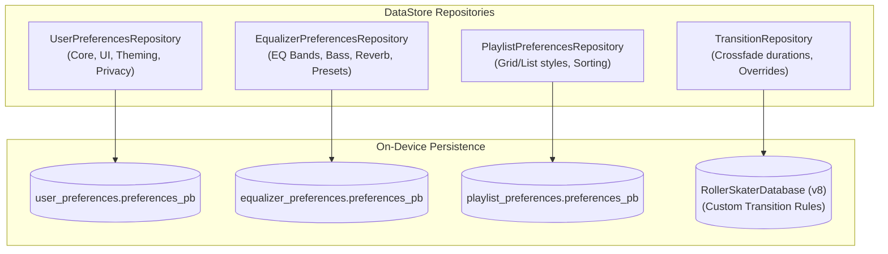

# RollerSkater — Configuration & Preferences Manual

RollerSkater provides deep runtime and build-time configurability while ensuring all user preferences remain strictly on-device.

This document details the configuration repositories, storage formats, preference keys, and Gradle compilation flags.

---

## 1. Runtime Preferences Architecture

Runtime user preferences are stored asynchronously using **Jetpack DataStore** (backed by Coroutines and Kotlin Flow) rather than legacy, blocking `SharedPreferences`.

DataStore instances are injected as singletons via Hilt across dedicated repositories in `com.rollerskater.app.data.preferences`:



---

## 2. Core User Preferences (`UserPreferencesRepository`)

Implemented in [`UserPreferencesRepository.kt`](../app/src/main/java/com/rollerskater/app/data/preferences/UserPreferencesRepository.kt):

| Preference Key | Type | Default Value | Description |
|---|---|---|---|
| `dark_mode_preference` | String | `FOLLOW_SYSTEM` | Options: `FOLLOW_SYSTEM`, `LIGHT`, `DARK`. |
| `pure_black_dark_theme` | Boolean | `false` | When enabled with dark mode, sets backgrounds to pure OLED black (`#000000`). |
| `palette_style` | String | `DYNAMIC` | Color extraction role from album artwork (`DYNAMIC`, `VIBRANT`, `MUTED`, `MONOCHROME`). |
| `external_artist_images` | Boolean | `false` | **100% Opt-In**: When true, downloads artist photos from the public Deezer API. |
| `external_lyrics_enabled` | Boolean | `false` | **100% Opt-In**: When true, queries LRCLIB for missing lyrics. |
| `auto_update_checks` | Boolean | `false` | When true, WorkManager periodically checks F-Droid or GitHub Releases for new versions. |
| `library_tabs_order` | List<String> | `[SONGS, ALBUMS, ARTISTS, GENRES, PLAYLISTS, FOLDERS, FAVORITES]` | User-reordered sequence of library tabs. |
| `artist_delimiters` | Set<String> | `[";", "/", "&", "feat.", "ft.", ","]` | Characters and tokens used to split collaborating artists. |
| `folder_artwork_enabled` | Boolean | `true` | Reads local directory cover files (`cover.jpg`, `folder.jpg`). |
| `gapless_playback` | Boolean | `true` | Enables zero-latency gapless transitions for lossless formats. |
| `replaygain_mode` | String | `ALBUM` | Options: `OFF`, `TRACK`, `ALBUM`. Automatic loudness normalization. |
| `replaygain_preamp_db` | Float | `0.0f` | Manual pre-amplification offset in decibels (-12 dB to +12 dB). |
| `audio_offload_enabled` | Boolean | `true` | Enables DSP hardware audio offload with 1,500ms stall fallback. |

---

## 3. Equalizer & Audio Curves (`EqualizerPreferencesRepository`)

Implemented in [`EqualizerPreferencesRepository.kt`](../app/src/main/java/com/rollerskater/app/data/preferences/EqualizerPreferencesRepository.kt):

| Preference Key | Type | Default Value | Description |
|---|---|---|---|
| `equalizer_enabled` | Boolean | `false` | Master toggle for Android DSP equalizer effect. |
| `active_preset_name` | String | `"Flat"` | Name of the active built-in or custom user curve. |
| `band_levels` | Map<Int, Int> | `{0: 0, 1: 0, ...}` | Level per band in millibels (typically -1500 mB to +1500 mB). |
| `bass_boost_strength` | Int | `0` | Bass boost intensity from `0` to `1000`. |
| `virtualizer_strength` | Int | `0` | Stereo widening intensity from `0` to `1000`. |
| `reverb_preset` | String | `"None"` | Presets: `None`, `SmallRoom`, `MediumRoom`, `LargeRoom`, `MediumHall`, `LargeHall`, `Plate`. |

---

## 4. Audio Transitions & Crossfade (`TransitionRepository`)

Implemented in [`TransitionRepository.kt`](../app/src/main/java/com/rollerskater/app/data/repository/TransitionRepository.kt):

- **Default Transition**: Gapless playback with sample-exact frame stitching.
- **Parametric Crossfade**: Configurable fade duration between **0 ms** (instant) and **15,000 ms** (15 seconds).
- **Trigonometric Power Law**: Volume interpolation adheres strictly to constant acoustic power:
  $$\text{Gain}_{\text{in}}(t) = \sin\left(\frac{\pi}{2} \cdot t\right), \quad \text{Gain}_{\text{out}}(t) = \cos\left(\frac{\pi}{2} \cdot t\right)$$
  $$\sin^2\left(\frac{\pi}{2} \cdot t\right) + \cos^2\left(\frac{\pi}{2} \cdot t\right) = 1.0$$
- **Custom Rule Overrides**: Rules stored in Room table `transition_rules` can override crossfade duration for specific track-to-track pairings or artist playlists.

---

## 5. Build-Time Gradle Configuration Flags

Flags configured via `gradle.properties` or passed through command-line `-Pkey=value`:

| Property Key | Type | Default | Description |
|---|---|---|---|
| `APP_VERSION_NAME` | String | `1.0.0` | Public application version string displayed in UI. |
| `APP_VERSION_CODE` | Int | `1` | Monotonically increasing Android versionCode. |
| `rollerskater.enableAbiSplits` | Boolean | `true` (APK) / `false` (AAB) | Generates architecture-specific split APKs (`arm64-v8a`, `armeabi-v7a`). |
| `rollerskater.disableReleaseSigning` | Boolean | `false` | Produces unsigned release binaries even when a keystore is configured. |
| `rollerskater.enableComposeCompilerReports` | Boolean | `false` | Dumps stability and metric reports into `app/build/compose_compiler_reports/`. |
| `org.gradle.jvmargs` | String | `-Xmx4096m ...` | JVM memory heap allocated to the Gradle daemon. |

---

## 6. Local Release Signing Configuration (`keystore.properties`)

To sign release builds locally, place a `keystore.properties` at the project root:

```properties
storeFile=rollerskater.jks
storePassword=YourKeystorePasswordHere
keyAlias=rollerskater-key
keyPassword=YourKeyPasswordHere
```

> [!CAUTION]
> Never commit `keystore.properties` or `*.jks` keystore files to git. Both patterns are strictly ignored by `.gitignore` and `.gitattributes`.
